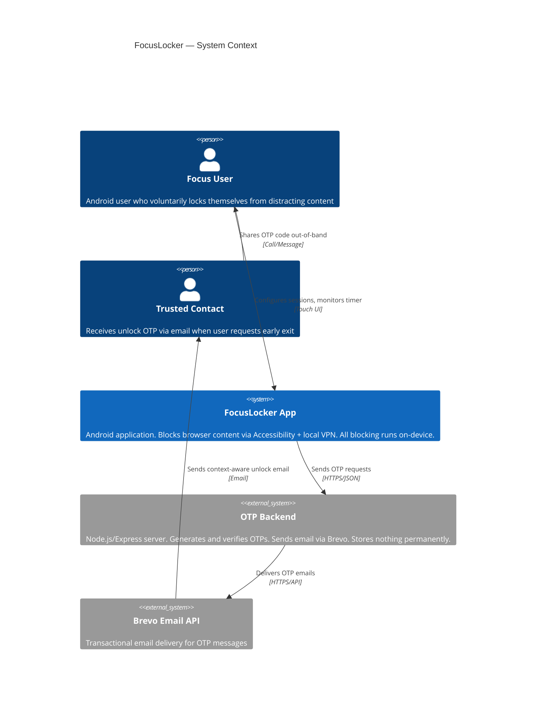
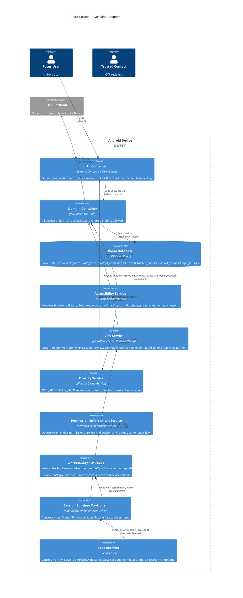

# FocuseLocker — Architectural Reference

> **C4 Container Model** | Generated from graphify-out (2346 nodes · 2122 edges · 404 communities)
> *Last updated: 2026-06-25 | Verified against GRAPH_REPORT.md commit*

---

## 1. System Context (C4 Level 1)



---

## 2. Container Diagram (C4 Level 2)



---

## 3. Container Inventory

### 3.1 UI Container

- **Name**: UI / Presentation
- **Type**: Android Application (Jetpack Compose)
- **Technology**: Kotlin 2.0+, Jetpack Compose, Material 3, Hilt, StateFlow
- **Start Destination**: `Screen.Onboarding`
- **Key Screens**: Onboarding, PermissionSetup, TrustedContactSetup, VerifyContact, CategorySelection, KeywordSelection, TimerSetup, SessionConfirmation, ActiveSession, UnlockRequest, OtpEntry, EmergencyBypass, SessionComplete

**Component → ViewModel mapping (from graphify Community 8, 30, 61, 77):**

| Screen | ViewModel | Key UseCases |
|--------|-----------|--------------|
| Onboarding | `OnboardingViewModel` | `InitializeAppUseCase`, `CheckOnboardingStatusUseCase` |
| PermissionSetup | `PermissionSetupViewModel` | `AppPermissionStatusProvider` |
| TrustedContactSetup | `TrustedContactSetupViewModel` | `SaveTrustedContactUseCase` |
| VerifyContact | `VerifyContactViewModel` | `VerifyContactOtpUseCase` |
| CategorySelection | `CategorySelectionViewModel` | `GetAllCategoriesUseCase`, `ToggleCategoryUseCase` |
| KeywordSelection | `KeywordSelectionViewModel` | `GetAllKeywordsUseCase`, `AddKeywordUseCase`, `RemoveKeywordUseCase` |
| TimerSetup | `TimerSetupViewModel` | — |
| SessionConfirmation | `SessionConfirmationViewModel` | `ActivateSessionUseCase` |
| ActiveSession | `ActiveSessionViewModel` | `GetSessionRemainingTimeUseCase`, `IsSessionActiveUseCase` |
| Unlock | `UnlockViewModel` | `RequestUnlockUseCase`, `VerifyUnlockOtpUseCase`, `StartEmergencyBypassUseCase` |

### 3.2 Domain Container

- **Name**: Domain / Business Logic
- **Type**: Pure Kotlin library (no Android imports)
- **Technology**: Kotlin coroutines, sealed classes
- **Enforced rule**: Domain Agent output must never contain Android imports, Retrofit, or Room

**UseCases (verified from graphify Communities 108–133):**

| UseCase | Purpose |
|---------|---------|
| `ActivateSessionUseCase` | Session initiation with `MIN_DURATION_MILLIS` guard |
| `DeactivateSessionUseCase` | Clean session teardown |
| `CheckOnboardingStatusUseCase` | Returns `OnboardingStatus(isOnboardingComplete, hasVerifiedContact, hasActiveSession)` |
| `InitializeAppUseCase` | Domain seeding gated by `DOMAINS_SEEDED` idempotency flag |
| `SmartScanUseCase` | AhoCorasick keyword scan + DoH race with fail-open default |
| `CheckUrlForBlockedContentUseCase` | URL-level check used by both services |
| `DoHQueryUseCase` | DNS-over-HTTPS query with retry mechanism |
| `GetActiveBlockedDomainsUseCase` | Excludes temporary auto-blocked entries |
| `GetActiveKeywordsUseCase` | In-memory keyword list for scanner |
| `GetAllCategoriesUseCase` | Category list with toggle state |
| `GetAllKeywordsUseCase` | Full keyword list with max-50 enforcement |
| `AddKeywordUseCase` / `RemoveKeywordUseCase` | Keyword CRUD |
| `ToggleCategoryUseCase` | Category on/off toggle |
| `SaveTrustedContactUseCase` | Contact registration + OTP dispatch |
| `VerifyContactOtpUseCase` | Contact OTP verification |
| `RequestUnlockUseCase` | Send unlock OTP to trusted contact |
| `VerifyUnlockOtpUseCase` | Verify unlock OTP (max 3 attempts) |
| `StartEmergencyBypassUseCase` | 24-hour emergency bypass with mandatory wait |
| `IsSessionActiveUseCase` | Session state check |
| `GetSessionRemainingTimeUseCase` | Timer countdown |
| `CleanupStaleSessionUseCase` | Clears expired sessions |
| `HasVerifiedContactUseCase` | Guard before session activation |

**Support components:**
- `AhoCorasick` — multi-pattern string matching (god node: high connectivity)
- `MetaDescriptionFetcher` — async page metadata fetch with SSRF protection and timeout
- `KeywordScanner` — wraps AhoCorasick for URL scanning
- `BootstrapDns` — DoH bootstrap DNS resolver

### 3.3 Room Database Container

- **Name**: FocusDatabase (SQLite via Room)
- **Type**: Embedded database
- **Technology**: Room 2.x, Kotlin Flow, SQLite

| Table | DAO | Key Rule |
|-------|-----|---------|
| `sessions` | `SessionDao` | One `ACTIVE` row max; `expires_at` is source of truth |
| `blocked_keywords` | `BlockedKeywordDao` | Max 50 rows; stored lowercase |
| `blocked_categories` | `BlockedCategoryDao` | 6 category toggles |
| `blocked_domains` | `BlockedDomainDao` | 58,000+ rows; `domain` column indexed; excludes temp auto-blocked |
| `trusted_contacts` | `TrustedContactDao` | Max 1 row for MVP |
| `unlock_requests` | `UnlockRequestDao` | Max 3 OTP attempts per request |
| `app_settings` | `AppSettingDao` | Key-value: `DOMAINS_SEEDED`, onboarding state, `ENFORCEMENT_STATE` |

**Graph hub nodes**: `BlockedDomainDao_Impl` (17 edges), `BlockedDomainDao` (16 edges), `FocusDatabase_Impl` (14 edges)

### 3.4 Accessibility Service Container

- **Name**: FocusAccessibilityService
- **Type**: Android AccessibilityService (foreground)
- **Technology**: Android Accessibility API, Kotlin coroutines
- **Graphify**: Community 23 — isolated node (high cohesion = 0.15)

**Interfaces:**
- Listens: `TYPE_WINDOW_CONTENT_CHANGED`, `TYPE_WINDOW_STATE_CHANGED`
- Supports: 10 browsers (Chrome, Firefox, Brave, Opera, Edge, DuckDuckGo, Samsung, Kiwi, UC + Settings)
- On URL change: runs AhoCorasick scan → if miss, async `SmartScanUseCase` + DoH race (`select{}` pattern)
- On match: `performGlobalAction(BACK)` + starts `BlockingOverlayService`
- On Settings navigation: deploys overlay to block permission tampering

**Reboot survival**: OEM-dependent. Battery optimization exemption is single most critical factor. Xiaomi/Samsung/OPPO kill without it.

### 3.5 VPN Service Container

- **Name**: FocusVpnService + VpnPacketLoop
- **Type**: Android VpnService (local TUN, no external server)
- **Technology**: Android VpnService API, raw DNS packet parsing, DoH via OkHttp
- **Graphify**: Community 36 (`FocusVpnService`), Community 29 (`VpnPacketLoop`) — both isolated high-cohesion nodes

**Interfaces:**
- Creates local TUN interface
- `VpnPacketLoop`: reads DNS queries, checks `BlockedDomainDao`, returns NXDOMAIN or forwards via DoH
- `ProtectedSocketFactory`: prevents tunnel recursion loop (`DNS_PROBE_POSSIBLE`)
- `BootstrapDns`: bypass resolver for DoH upstream
- Object-pooled `ByteArray` buffers: eliminates GC pressure at high packet frequency

**Dependencies:**
- `BlockingRepository` → Room DB
- `DoHQueryUseCase` → DoH upstream (with retry on transient failures)
- `ProtectedSocketFactory` → Android `VpnService.protect()`

### 3.6 Overlay Service Container

- **Name**: BlockingOverlayService
- **Type**: Android Service with `TYPE_APPLICATION_OVERLAY` window
- **Technology**: Android WindowManager, Jetpack Compose
- **Graphify**: Community 28

**Interfaces:**
- Draws full-screen overlay over blocked content
- Non-dismissible via back button during active session
- Shows time remaining + blocked content reason

### 3.7 Permission Enforcement Service Container *(New — Phase 7)*

- **Name**: PermissionEnforcementService
- **Type**: Android Service / State Monitor
- **Technology**: Kotlin coroutines, `PreferencesSessionEnforcementStateStore`
- **Graphify**: Community 16 (isolated, cohesion 0.14); Community 93 (`PreferencesSessionEnforcementStateStore`)

**Purpose**: Detects at runtime when critical permissions (Accessibility, VPN) are lost mid-session due to OEM kill or user action. Routes user back to onboarding permission-repair screen before any new session can start.

**Dependencies:**
- `PreferencesSessionEnforcementStateStore` — persists enforcement state across process restarts
- `PermissionChecker` — stateless OS permission query utility
- Navigation → `Screen.PermissionSetup` (via onboarding smart router)

### 3.8 Session Runtime Controller Container

- **Name**: AndroidSessionRuntimeController (concrete class)
- **Type**: Singleton (Hilt-injected)
- **Technology**: Kotlin coroutines, Android Service lifecycle
- **Graphify**: Community 92 (`AndroidSessionRuntimeController_Factory`)
- **Note**: Was previously an interface; refactored to concrete class in Phase 7 cleanup

**Responsibilities:**
- `startRuntime()`: starts `FocusVpnService`, creates foreground notification via `SessionNotificationManager`
- `stopRuntime()`: stops VPN, dismisses notification, clears session state
- Called by: `ActivateSessionUseCase`, `DeactivateSessionUseCase`, `BootReceiver`

### 3.9 WorkManager Workers Container

- **Type**: WorkManager CoroutineWorker
- **Technology**: WorkManager, Kotlin coroutines
- **Graphify**: Communities 154–157

| Worker | Trigger | Purpose |
|--------|---------|---------|
| `SessionExpiryWorker` | Scheduled at session start | Fires `DeactivateSessionUseCase` at expiry |
| `CooldownTimerWorker` | Post-OTP verification | Enforces 10-min cooldown before unlock |
| `EmergencyBypassWorker` | Emergency bypass activation | Enforces 24-hour mandatory wait |
| `ListSyncWorker` | Periodic | Domain list sync from remote source (fixed: coroutine cancellation silent failure resolved) |

### 3.10 OTP Backend Container

- **Name**: FocusLocker OTP Server
- **Type**: REST API (stateless)
- **Technology**: Node.js 20 LTS, Express 5, TypeScript, Brevo Email API, bcrypt, zod
- **Deployment**: Railway.app
- **Storage**: In-memory Map with 10-min TTL only. **No database. No persistent storage.**

**API Specification:**

| Endpoint | Method | Input | Output |
|----------|--------|-------|--------|
| `/verify-contact` | POST | `{ email }` | `{ success: true }` |
| `/confirm-contact` | POST | `{ email, otp }` | `{ verified: boolean }` |
| `/request-unlock` | POST | `{ trustedContactEmail, blockedCategories, timeRemaining, requestTimestamp }` | `{ success: true }` |
| `/verify-unlock-otp` | POST | `{ trustedContactEmail, otp }` | `{ valid: boolean }` |

**Security contracts:**
- OTP: `crypto.randomInt(100000, 999999)` — never `Math.random()`
- Storage: bcrypt-hashed, 10-min TTL, deleted after use or max attempts
- No browsing data, keywords, or categories ever sent to backend

---

## 4. Execution Flows

### 4.1 App Launch Routing

```
User opens app
  → OnboardingViewModel.initialize()
    → InitializeAppUseCase() (DOMAINS_SEEDED idempotency gate — prevents 3–8s cold start on 2nd launch)
    → CheckOnboardingStatusUseCase()
      → OnboardingStatus.hasActiveSession → ActiveSessionScreen
      → OnboardingStatus.isComplete + permissions OK → CategorySelection
      → OnboardingStatus.isComplete + permissions broken → PermissionSetup (via PermissionEnforcementService route)
      → else → Welcome Screen (first-time user)
```

### 4.2 Domain Blocking Flow (Network Level)

```
User navigates to a domain
  → FocusVpnService captures DNS query via VpnPacketLoop
    → BlockedDomainDao check (indexed lookup, ~58k rows)
      → Blocked → NXDOMAIN response (inline, sub-ms)
      → Not blocked → DoH forward via BootstrapDns + ProtectedSocketFactory
        (retry on transient connectivity failure)
```

### 4.3 Keyword Blocking Flow (Accessibility Level)

```
User types URL in browser
  → FocusAccessibilityService detects TYPE_WINDOW_CONTENT_CHANGED
    → URL extracted via per-browser ViewID mapping (10 browsers supported)
      → AhoCorasick instant scan (in-memory, sub-ms)
        → Match → performGlobalAction(BACK) + BlockingOverlayService
        → No match → async select{ SmartScanUseCase, DoHQueryUseCase } race
          → Blocked → performGlobalAction(BACK) + overlay
          → Clear → Allow (fail-open)
```

### 4.4 Boot Recovery Flow

```
Phone reboots
  → ACTION_BOOT_COMPLETED → BootReceiver
    → SessionRepository.getActiveSession()
      → Session found + not expired → AndroidSessionRuntimeController.startRuntime()
                                    → SessionWorkerScheduler.reschedule()
      → Session found + expired → DeactivateSessionUseCase() → COMPLETED
      → No session → No action
    → OemAutostartHelper invoked (OEM-specific autostart intents for Xiaomi, Samsung, OPPO)
```

### 4.5 Unlock Flow

```
User requests early unlock
  → UnlockViewModel → RequestUnlockUseCase
    → POST /request-unlock (email, context, time remaining)
      → Brevo sends context-rich OTP email to trusted contact
  → Contact shares OTP out-of-band
  → User enters OTP → VerifyUnlockOtpUseCase
    → POST /verify-unlock-otp
      → Valid → CooldownTimerWorker scheduled (10 min)
      → Invalid (max 3) → Must request new OTP
  → Cooldown complete → DeactivateSessionUseCase → Session ends
```

---

## 5. Critical Node Analysis (from graphify)

### 5.1 God Nodes (Highest Connectivity = Largest Blast Radius)

| Node | Edges | Risk |
|------|-------|------|
| `SingletonCImpl` (Hilt) | 25 | All Hilt-injected singletons route through here |
| `ViewModelCImpl` (Hilt) | 21 | All ViewModels resolve here |
| `BlockingRepository` | 19 | Core blocking data hub — changes break domain + services |
| `BlockedDomainDao_Impl` | 17 | Performance-critical; 58k+ row table |
| `BlockedDomainDao` | 16 | Interface for all domain blocking queries |
| `DoHQueryUseCaseTest` | 16 | Most connected test — covers critical DoH path |
| `FocusDatabase_Impl` | 14 | Root of all Room operations |
| `BlockingRepositoryTest` | 13 | Primary data-layer integration gate |

### 5.2 Bridge Nodes (Chokepoints — Break These, Break Everything)

| Node | Connects |
|------|---------|
| `SmartScanUseCase` | Domain layer ↔ Network layer (DoH + metadata) |
| `FocusAccessibilityService` | Android OS events ↔ Domain blocking logic |
| `MetaDescriptionFetcher` | Domain decisions ↔ HTTP metadata (SSRF-protected) |
| `PermissionChecker` | OS permission state ↔ UI + PermissionEnforcementService |
| `VpnPacketLoopIntegrationTest` | Services ↔ Domain ↔ Data (test bridge) |

---

## 6. Permission Architecture

| Permission | Service | Reboot Survival | Recovery |
|-----------|---------|----------------|---------|
| `BIND_ACCESSIBILITY_SERVICE` | `FocusAccessibilityService` | ❌ OEM-dependent | User must manually re-enable; `PermissionEnforcementService` detects + prompts |
| `BIND_VPN_SERVICE` | `FocusVpnService` | ✅ via `BootReceiver` | `AndroidSessionRuntimeController.startRuntime()` |
| `BIND_DEVICE_ADMIN` | `FocusDeviceAdminReceiver` | ✅ System-managed | No action needed |
| `SYSTEM_ALERT_WINDOW` | `BlockingOverlayService` | ✅ System-managed | No action needed |
| `REQUEST_IGNORE_BATTERY_OPTIMIZATIONS` | All services | ✅ Critical gate | Must be enforced during onboarding — **#1 factor in OEM survival** |

---

## 7. Security & Stability

| Risk | Mitigation |
|------|-----------|
| DNS recursion loop | `ProtectedSocketFactory` + `BootstrapDns` prevent TUN self-query |
| SSRF via metadata fetch | `MetaDescriptionFetcher` validates host before HTTP request |
| False positive blocking | `SmartScanUseCase` fail-open: network error → allow traffic |
| GC pressure in VPN loop | Object-pooled `ByteArray` buffers in `VpnPacketLoop` |
| Coroutine silent failure | `ListSyncWorker` + `OnboardingViewModel` — supervisorScope with explicit error handling |
| OEM service kill | Battery optimization exemption + `OemAutostartHelper` (Xiaomi/Samsung/OPPO-specific intents) |
| DoH connectivity failure | Retry with exponential backoff in `DoHQueryUseCase` |
| Permissions lost mid-session | `PermissionEnforcementService` detects → routes to repair screen |

---

## 8. Dependency Injection Topology (Hilt)

```
DaggerFocusLockApplication_HiltComponents_SingletonC
  ├── SingletonCImpl (25 edges — all singletons)
  │   ├── DatabaseModule → FocusDatabase → all DAOs
  │   ├── NetworkModule → OkHttpClient → Retrofit → FocusLockApi
  │   ├── AndroidSessionRuntimeController
  │   ├── PreferencesSessionEnforcementStateStore
  │   └── all Repository implementations
  └── ViewModelCImpl (21 edges — all ViewModels via Hilt ViewModel factories)
      ├── OnboardingViewModel_HiltModules
      ├── PermissionSetupViewModel_HiltModules
      ├── ActiveSessionViewModel_HiltModules
      └── ... (10 total ViewModel Hilt modules)
```

---

## 9. Graph Health Indicators

| Metric | Value | Interpretation |
|--------|-------|---------------|
| Total nodes | 2,346 | Full production codebase (427 files, ~736k words) |
| Total edges | 2,122 | Reasonable coupling for Clean Architecture |
| Communities | 404 | High modularity — Hilt factories each form isolated units |
| Extraction accuracy | 97% EXTRACTED / 3% INFERRED | Highly reliable graph |
| God node concentration | Top 3 nodes: 25/21/19 edges | Acceptable — Hilt DI naturally concentrates at component level |
| Avg inferred edge confidence | 0.81 | High confidence on inferred relationships |

---

## 10. Recommendations

1. **Before touching `BlockingRepository`**: Run `DoHQueryUseCaseTest` + `BlockingRepositoryTest` — they are the highest-coverage bridges.
2. **Before touching `FocusAccessibilityService`**: Verify `PermissionEnforcementService` integration — these are now coupled via the repair flow.
3. **OEM hardening priority**: `OemAutostartHelper` is invoked by `BootReceiver` but coverage of manufacturer-specific intents varies. Prioritize Xiaomi MIUI + Samsung One UI.
4. **`ListSyncWorker` monitoring**: Fixed coroutine cancellation silent failure — add log assertions in test to catch regression.
5. **`PermissionEnforcementService` test gap**: Community 16 is isolated — `PermissionEnforcementServiceTest` (Community 82) exists but verify it covers the navigation-to-repair path.
