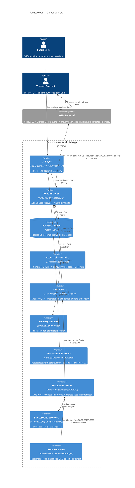
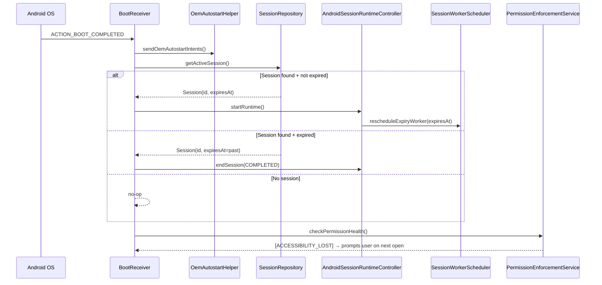
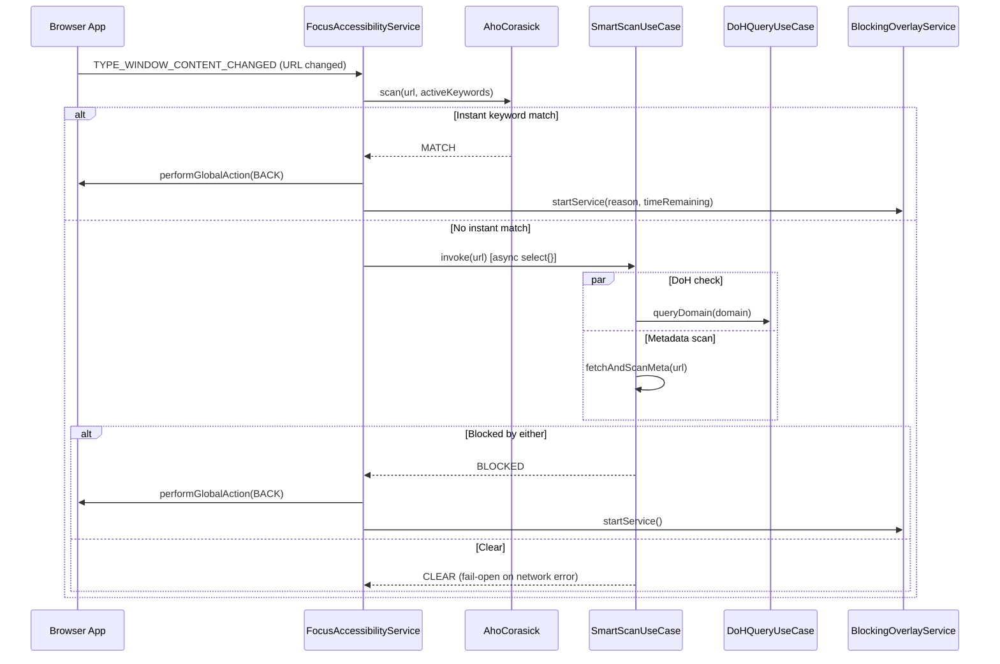

# FocuseLocker — C4 Architecture Diagrams

> Source of truth: `graphify-out/GRAPH_REPORT.md` (2346 nodes · 2122 edges · 404 communities)
> *Last updated: 2026-06-25*

---

## Diagram 1 — Layer Architecture (Mermaid)

```mermaid
graph TD
    classDef uiLayer fill:#E2E8F0,stroke:#64748B,stroke-width:2px,color:#0F172A;
    classDef domainLayer fill:#DBEAFE,stroke:#3B82F6,stroke-width:2px,color:#0F172A;
    classDef dataLayer fill:#DCFCE7,stroke:#22C55E,stroke-width:2px,color:#0F172A;
    classDef serviceLayer fill:#FEF9C3,stroke:#EAB308,stroke-width:2px,color:#0F172A;
    classDef hubNode fill:#FEE2E2,stroke:#EF4444,stroke-width:3px,color:#991B1B,font-weight:bold;
    classDef bridgeNode fill:#F3E8FF,stroke:#A855F7,stroke-width:3px,stroke-dasharray: 5 5,color:#581C87;
    classDef newNode fill:#FFF7ED,stroke:#F97316,stroke-width:3px,color:#7C2D12;

    subgraph Presentation ["📱 Presentation Layer (Compose)"]
        Nav[AppNavigation]:::hubNode
        OnboardVM[OnboardingViewModel]:::hubNode
        ActiveSession[ActiveSessionScreen]:::hubNode
        UnlockVM[UnlockViewModel]:::uiLayer
        PermEnforce[PermissionEnforcementService]:::newNode

        Nav --> ActiveSession
        Nav --> UnlockVM
        OnboardVM --> Nav
        PermEnforce --> Nav
    end

    subgraph ServiceOS ["⚙️ Service & OS Integration Layer"]
        AccessSvc[FocusAccessibilityService]:::bridgeNode
        VpnSvc[FocusVpnService]:::hubNode
        PacketLoop[VpnPacketLoop\n(object-pooled buffers)]:::bridgeNode
        Overlay[BlockingOverlayService]:::serviceLayer
        RuntimeCtrl[AndroidSessionRuntimeController]:::newNode
        BootRx[BootReceiver + OemAutostartHelper]:::serviceLayer

        VpnSvc --> PacketLoop
        AccessSvc --> Overlay
        RuntimeCtrl --> VpnSvc
        BootRx --> RuntimeCtrl
    end

    subgraph Workers ["🔧 WorkManager Workers"]
        SessionExpiry[SessionExpiryWorker]:::serviceLayer
        Cooldown[CooldownTimerWorker]:::serviceLayer
        Emergency[EmergencyBypassWorker]:::serviceLayer
        ListSync[ListSyncWorker\n(fixed: silent cancel)]:::serviceLayer

        RuntimeCtrl --> SessionExpiry
    end

    subgraph Domain ["🧠 Domain Layer (Pure Kotlin)"]
        SmartScan[SmartScanUseCase]:::bridgeNode
        ActivateSess[ActivateSessionUseCase]:::domainLayer
        UnlockFlow[RequestUnlockUseCase\nVerifyUnlockOtpUseCase]:::domainLayer
        Aho[AhoCorasick Engine]:::domainLayer
        DoH[DoHQueryUseCase\n(with retry)]:::domainLayer
        InitApp[InitializeAppUseCase\n(DOMAINS_SEEDED gate)]:::domainLayer

        OnboardVM --> InitApp
        UnlockVM --> UnlockFlow
        ActivateSess --> RuntimeCtrl
        PacketLoop --> DoH
        AccessSvc --> SmartScan
        SmartScan --> Aho
        SmartScan --> DoH
    end

    subgraph Data ["💾 Data Layer (Room SQLite)"]
        BlockRepo[BlockingRepository\n19 edges — hub]:::hubNode
        DomainDao[BlockedDomainDao\n58k+ rows]:::dataLayer
        SessionDao[SessionDao]:::dataLayer
        AppSettingsRepo[AppSettingsRepository\nDOMAINS_SEEDED flag]:::dataLayer
        MetaFetch[MetaDescriptionFetcher\nSSRF-protected]:::bridgeNode

        SmartScan --> BlockRepo
        SmartScan --> MetaFetch
        BlockRepo --> DomainDao
        ActivateSess --> SessionDao
        InitApp --> AppSettingsRepo
    end

    subgraph Backend ["☁️ OTP Backend (Node.js + Brevo)"]
        OtpServer[Express OTP Server\nBrevo Email API]:::serviceLayer

        UnlockFlow --> OtpServer
    end
```

---

## Diagram 2 — C4 Container (Mermaid C4Container)



---

## Diagram 3 — Boot Recovery Sequence



---

## Diagram 4 — Keyword Blocking Sequence


