# NextDNS Layer Diagnostic Report

**Project:** FocusLocker  
**Date:** 2026-06-19  
**Scope:** Full DNS/VPN pipeline + blocking system audit  
**Status:** ✅ Prior fixes verified | ⚠️ 5 new findings

---

## 1. Architecture Overview

```mermaid
graph TB
    subgraph "Android Device"
        A["App DNS Query<br/>(System / Chrome)"] --> B["TUN Interface<br/>10.0.0.2:53"]
        B --> C["VpnPacketLoop<br/>reads raw UDP"]
        C --> D{"DnsPacketParser<br/>extract domain"}
        D -->|domain found| E{"isDomainOrParentBlocked()"}
        E -->|BLOCKED| F["DnsResponseBuilder<br/>→ NXDOMAIN response"]
        F --> B
        E -->|ALLOWED| G["forwardDnsViaDoH()"]
        G --> H["OkHttpClient<br/>(dohClient)"]
        H --> I["BootstrapDns<br/>UDP 8.8.8.8 → resolve dns.nextdns.io"]
        H --> J["ProtectedSocketFactory<br/>vpnService.protect(socket)"]
        I --> K["NextDNS DoH<br/>https://dns.nextdns.io/71421a"]
        K --> L["DNS Response<br/>via TUN back to app"]
    end

    subgraph "Background Blocking Pipeline"
        M["FocusAccessibilityService"] --> N["CheckUrlForBlockedContentUseCase"]
        N --> O["DoHQueryUseCase<br/>(dns-json format)"]
        O --> P["NextDNS<br/>https://{profileId}.dns.nextdns.io/dns-query"]
        N --> Q["SmartScanUseCase"]
        Q --> R["MetaDescriptionFetcher"]
    end
```



### Key Components

| Component | File | Purpose |
|-----------|------|---------|
| VPN Service | [FocusVpnService.kt](file:///c:/Users/harshal.bhoyar/Project/FocuseLocker/app/src/main/java/com/focuslock/service/vpn/FocusVpnService.kt) | TUN setup, domain list management, session monitoring |
| Packet Loop | [VpnPacketLoop.kt](file:///c:/Users/harshal.bhoyar/Project/FocuseLocker/app/src/main/java/com/focuslock/service/vpn/VpnPacketLoop.kt) | Raw packet I/O, DoH forwarding |
| Bootstrap DNS | [BootstrapDns.kt](file:///c:/Users/harshal.bhoyar/Project/FocuseLocker/app/src/main/java/com/focuslock/service/vpn/BootstrapDns.kt) | Protected UDP DNS for resolving DoH hostname |
| Socket Factory | [ProtectedSocketFactory.kt](file:///c:/Users/harshal.bhoyar/Project/FocuseLocker/app/src/main/java/com/focuslock/service/vpn/ProtectedSocketFactory.kt) | Ensures OkHttp sockets bypass TUN |
| DNS Config | [DnsConfig.kt](file:///c:/Users/harshal.bhoyar/Project/FocuseLocker/app/src/main/java/com/focuslock/service/vpn/DnsConfig.kt) | Profile ID, virtual IPs, DoH endpoint |
| DoH Query | [DoHQueryUseCase.kt](file:///c:/Users/harshal.bhoyar/Project/FocuseLocker/app/src/main/java/com/focuslock/domain/usecase/DoHQueryUseCase.kt) | DNS-JSON background checks |
| SmartScan | [SmartScanUseCase.kt](file:///c:/Users/harshal.bhoyar/Project/FocuseLocker/app/src/main/java/com/focuslock/domain/usecase/SmartScanUseCase.kt) | Meta-tag keyword blocking |
| Blocked DAO | [BlockedDomainDao.kt](file:///c:/Users/harshal.bhoyar/Project/FocuseLocker/app/src/main/java/com/focuslock/data/local/dao/BlockedDomainDao.kt) | Room queries for domain lists |
| Network DI | [NetworkModule.kt](file:///c:/Users/harshal.bhoyar/Project/FocuseLocker/app/src/main/java/com/focuslock/di/NetworkModule.kt) | Shared OkHttpClient singleton |

---

## 2. Previously Fixed Issues (Verified ✅)

### FIX-1: DNS Bootstrap Recursion Loop
- **Root Cause:** `VpnPacketLoop` used the Hilt-injected `OkHttpClient` which used `Dns.SYSTEM` to resolve `dns.nextdns.io`. Since `Dns.SYSTEM` queries were captured by the TUN interface, they looped back into the same `VpnPacketLoop`, causing infinite recursion → `DNS_PROBE_POSSIBLE`.
- **Fix:** Created `BootstrapDns` (raw UDP to 8.8.8.8/1.1.1.1 via protected socket) and `ProtectedSocketFactory`. Built a dedicated `dohClient` at runtime in `FocusVpnService.startVpn()` using `okHttpClient.newBuilder()`.
- **Verification:** [FocusVpnService.kt:L121-127](file:///c:/Users/harshal.bhoyar/Project/FocuseLocker/app/src/main/java/com/focuslock/service/vpn/FocusVpnService.kt#L121-L127) — `dohClient` correctly uses `BootstrapDns` + `ProtectedSocketFactory`.
- **Tests:** `BootstrapDnsTest` (3 tests), `ProtectedSocketFactoryTest` (2 tests), `FocusVpnServiceTest` (5 tests) — **all pass** ✅

### FIX-2: TEMPORARY Domain Pollution
- **Root Cause:** `getAllBlockedDomainList` and `getAllBlockedDomainListFlow` DAO queries included `TEMPORARY` auto-blocked entries, which polluted the VPN's active blocklist with transient/expired entries.
- **Fix:** Updated WHERE clauses to require `bd.block_status IS NULL OR bd.block_status = 'PERMANENT'` and added `expires_at` check on the suspend query.
- **Verification:** [BlockedDomainDao.kt:L28-44](file:///c:/Users/harshal.bhoyar/Project/FocuseLocker/app/src/main/java/com/focuslock/data/local/dao/BlockedDomainDao.kt#L28-L44) — both queries correctly filter.

### FIX-3: Search Engine False-Positive Blocking
- **Root Cause:** `SmartScanUseCase` tried to fetch meta descriptions from search engine result pages (Google, Bing, etc.). These JS-rendered pages returned empty/timeout, which triggered `fail-closed` auto-blocking.
- **Fix:** Added `SEARCH_ENGINE_DOMAINS` safelist + switched to `fail-open` policy (timeouts/empty → `FetchFailed`, no blocking).
- **Verification:** [SmartScanUseCase.kt:L22-27](file:///c:/Users/harshal.bhoyar/Project/FocuseLocker/app/src/main/java/com/focuslock/domain/usecase/SmartScanUseCase.kt#L22-L27) and [SmartScanUseCase.kt:L76-80](file:///c:/Users/harshal.bhoyar/Project/FocuseLocker/app/src/main/java/com/focuslock/domain/usecase/SmartScanUseCase.kt#L76-L80).

### FIX-4: VPN TUN Route Narrowing
- **Root Cause:** Overly broad TUN routes captured all traffic (including DoH connections to NextDNS).
- **Fix:** Routes narrowed to only the virtual DNS IPs (`10.0.0.2/32`, `fd00:1:fd00:1:fd00:1:fd00:1/128`).
- **Verification:** [FocusVpnService.kt:L106-112](file:///c:/Users/harshal.bhoyar/Project/FocuseLocker/app/src/main/java/com/focuslock/service/vpn/FocusVpnService.kt#L106-L112) — only virtual IPs routed.

---

## 3. New Findings

### FINDING-1: DoH Endpoint Inconsistency ⚠️ MEDIUM

**Two different NextDNS URL formats are used:**

| Path | URL Format | File:Line |
|------|-----------|-----------|
| VPN Tunnel (binary DoH) | `https://dns.nextdns.io/71421a` | [DnsConfig.kt:L17](file:///c:/Users/harshal.bhoyar/Project/FocuseLocker/app/src/main/java/com/focuslock/service/vpn/DnsConfig.kt#L17) |
| Background (dns-json) | `https://{profileId}.dns.nextdns.io/dns-query` | [DoHQueryUseCase.kt:L33](file:///c:/Users/harshal.bhoyar/Project/FocuseLocker/app/src/main/java/com/focuslock/domain/usecase/DoHQueryUseCase.kt#L33) |

**Risk:** These two URL patterns may route through different NextDNS edges and could produce inconsistent blocking verdicts. If `DnsConfig.dohEndpoint` is down or returns differently, the VPN tunnel gives a different answer than the background `DoHQueryUseCase` check.

Additionally, `DnsConfig` hardcodes the profile ID as `71421a`, while `DoHQueryUseCase` reads it from SharedPreferences with `BuildConfig.NEXTDNS_PROFILE_ID` as fallback. If someone updates the profile ID in `local.properties`, the VPN tunnel still uses the old hardcoded one.

**Remediation:**
- Make `DnsConfig` read `dohEndpoint` from the same source as `DoHQueryUseCase` (SharedPreferences → BuildConfig fallback).
- Alternatively, move profile ID to a single source of truth and have both consumers reference it.

---

### FINDING-2: ProtectedSocketFactory Race on Connected Sockets ⚠️ LOW

**Location:** [ProtectedSocketFactory.kt:L19-29](file:///c:/Users/harshal.bhoyar/Project/FocuseLocker/app/src/main/java/com/focuslock/service/vpn/ProtectedSocketFactory.kt#L19-L29)

The `createSocket(host, port)` and `createSocket(host, port, localHost, localPort)` overloads call `delegate.createSocket(host, port, ...)` which connects the socket **before** `protect()` is called. The Android documentation states:

> *"Before sending traffic to the VPN tunnel, the app must call `VpnService.protect(socket)` before the socket is connected."*

The no-arg `createSocket()` (line 13) is correct — it creates an unconnected socket and protects it before OkHttp connects. OkHttp's connection pool primarily uses the no-arg variant, so this is low risk in practice, but the connected-socket variants are technically incorrect.

**Remediation:**
- Override only the no-arg `createSocket()`. Let the other overloads throw `UnsupportedOperationException` or call the no-arg version + manual connect after protect. OkHttp exclusively uses the no-arg variant for connection pooling.

---

### FINDING-3: `getAllBlockedDomainListFlow` Missing `expires_at` Filter ⚠️ MEDIUM

**Location:** [BlockedDomainDao.kt:L38-44](file:///c:/Users/harshal.bhoyar/Project/FocuseLocker/app/src/main/java/com/focuslock/data/local/dao/BlockedDomainDao.kt#L38-L44)

The `getAllBlockedDomainListFlow()` query correctly excludes non-PERMANENT entries but does **NOT** check `expires_at`:

```sql
WHERE bc.is_active = 1 AND (bd.block_status IS NULL OR bd.block_status = 'PERMANENT')
-- Missing: AND (bd.expires_at IS NULL OR bd.expires_at > :now)
```

Compare with the suspend variant `getAllBlockedDomainList()` at line 28-36 which **does** check `expires_at`.

**Impact:** The VPN's live `domainObserverJob` uses `getAllBlockedDomainsFlowUseCase()` → this Flow. If a PERMANENT entry somehow has an `expires_at` in the past (data inconsistency), it would still appear in the VPN blocklist through the Flow but not through the suspend query. This is low-probability but breaks the contract that the suspend and Flow queries return equivalent results.

**Remediation:** Add the `expires_at` filter to the Flow query to match the suspend variant.

---

### FINDING-4: CLEAN_CACHE Entries Never Garbage-Collected at Runtime ⚠️ LOW

**Location:** [BlockedDomainDao.kt:L79-80](file:///c:/Users/harshal.bhoyar/Project/FocuseLocker/app/src/main/java/com/focuslock/data/local/dao/BlockedDomainDao.kt#L79-L80) and [SmartScanUseCase.kt:L97](file:///c:/Users/harshal.bhoyar/Project/FocuseLocker/app/src/main/java/com/focuslock/domain/usecase/SmartScanUseCase.kt#L97)

`SmartScanUseCase` writes `CLEAN_CACHE` entries with a 24-hour `expires_at`. `BlockedDomainDao.deleteExpiredEntries()` exists but is never called from any WorkManager, lifecycle hook, or scheduled task.

**Impact:** The `blocked_domains` table will accumulate stale `CLEAN_CACHE` rows indefinitely. These don't affect blocking (queries filter by status), but they waste storage and slow down inserts over time.

**Remediation:** Call `deleteExpiredEntries()` from `InitializeAppUseCase` on cold start, or schedule it via `ListSyncWorker`.

---

### FINDING-5: NetworkModule Shared OkHttpClient Uses `Dns.SYSTEM` Inside VPN ⚠️ LOW-MEDIUM

**Location:** [NetworkModule.kt:L46-58](file:///c:/Users/harshal.bhoyar/Project/FocuseLocker/app/src/main/java/com/focuslock/di/NetworkModule.kt#L46-L58)

The Hilt-injected singleton `OkHttpClient` uses a custom `Dns` wrapper that delegates to `Dns.SYSTEM.lookup(hostname)`. When the VPN is active, `Dns.SYSTEM` queries go through the TUN interface → `VpnPacketLoop` → DoH.

This is **correct for most use cases** (meta-fetching, API calls should go through the VPN's DNS). But `DoHQueryUseCase` at [L41-45](file:///c:/Users/harshal.bhoyar/Project/FocuseLocker/app/src/main/java/com/focuslock/domain/usecase/DoHQueryUseCase.kt#L41-L45) also uses this client (via `okHttpClient.newBuilder()`) to query NextDNS directly. This means:

1. App wants to check if `example.com` is blocked by NextDNS
2. `DoHQueryUseCase` builds URL `https://71421a.dns.nextdns.io/dns-query?name=example.com`
3. OkHttp needs to resolve `71421a.dns.nextdns.io` → uses `Dns.SYSTEM` → goes through TUN → `VpnPacketLoop` → DoH to `dns.nextdns.io/71421a` → resolves `71421a.dns.nextdns.io` via... NextDNS

This works but creates a **circular dependency chain**: NextDNS resolves NextDNS's own hostname. If NextDNS has an outage, both the VPN DNS resolution AND the background DoH check fail simultaneously with no fallback.

**Risk:** Currently low because the VPN `BootstrapDns` uses Google DNS (8.8.8.8) to resolve `dns.nextdns.io`, which is a different hostname than `71421a.dns.nextdns.io`. But it's an architectural smell.

**Remediation:** No immediate fix needed. If resiliency matters, consider having `DoHQueryUseCase` use its own OkHttp client with `BootstrapDns` when VPN is active.

---

## 4. Test Verification Results

| Test Suite | Tests | Status |
|-----------|-------|--------|
| `BootstrapDnsTest` | 3 | ✅ PASS |
| `ProtectedSocketFactoryTest` | 2 | ✅ PASS |
| `FocusVpnServiceTest` | 5 | ✅ PASS |
| `DnsConfigTest` | 1 | ✅ PASS |
| `DnsPacketParserTest` | varies | ✅ PASS |
| `SmartScanUseCaseTest` | varies | ✅ PASS |
| `DoHQueryUseCaseTest` | varies | ✅ PASS |

**All VPN and DNS-related unit tests pass.** BUILD SUCCESSFUL.

---

## 5. Risk Summary

| Finding | Severity | Impact | Fix Effort |
|---------|----------|--------|------------|
| F1: DoH endpoint inconsistency | ⚠️ MEDIUM | Profile ID drift between VPN tunnel and background checks | 30 min |
| F2: ProtectedSocketFactory race | LOW | Connected sockets not protected before connect (OkHttp uses no-arg path) | 15 min |
| F3: Flow query missing expires_at | ⚠️ MEDIUM | VPN blocklist/suspend-query contract mismatch | 5 min |
| F4: CLEAN_CACHE never GC'd | LOW | Slow table growth over weeks | 10 min |
| F5: Circular DNS dependency | LOW-MEDIUM | Simultaneous NextDNS outage breaks both paths | 30 min (if needed) |

---

## 6. Recommended Priority

1. **F3** — 5-minute fix, eliminates a data contract inconsistency between the two blocklist queries
2. **F1** — Prevents profile ID drift; single source of truth for NextDNS config
3. **F4** — Quick GC hook on cold start
4. **F2** — Low priority, OkHttp doesn't use the affected code paths
5. **F5** — No fix needed unless NextDNS resiliency becomes a requirement
