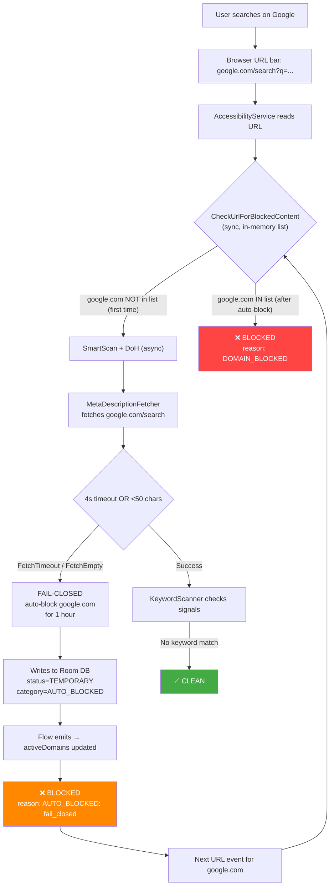

# FocusLocker Search Engine Blocking — Root Cause Investigation

## Symptoms Reported
1. Every search engine blocked after performing any web search
2. Overlay shows: **Domain Name = search engine**, **Reason = DOMAIN_BLOCKED**
3. Sometimes shows: **Blocked content detect = timeout**, **Reason = AUTO_BLOCKED: fail_closed**
4. NextDNS logs show **0 logs** (nothing)

---

## Investigation Scope
All findings below are based on direct source code inspection of the following files:

| File | Role |
|------|------|
| [FocusAccessibilityService.kt](file:///c:/Users/harshal.bhoyar/Project/FocuseLocker/app/src/main/java/com/focuslock/service/accessibility/FocusAccessibilityService.kt) | URL interception + blocking orchestrator |
| [CheckUrlForBlockedContentUseCase.kt](file:///c:/Users/harshal.bhoyar/Project/FocuseLocker/app/src/main/java/com/focuslock/domain/usecase/CheckUrlForBlockedContentUseCase.kt) | Synchronous domain/keyword check |
| [SmartScanUseCase.kt](file:///c:/Users/harshal.bhoyar/Project/FocuseLocker/app/src/main/java/com/focuslock/domain/usecase/SmartScanUseCase.kt) | Async meta-fetch + keyword scan |
| [MetaDescriptionFetcher.kt](file:///c:/Users/harshal.bhoyar/Project/FocuseLocker/app/src/main/java/com/focuslock/domain/usecase/MetaDescriptionFetcher.kt) | HTTP fetch of page signals |
| [DoHQueryUseCase.kt](file:///c:/Users/harshal.bhoyar/Project/FocuseLocker/app/src/main/java/com/focuslock/domain/usecase/DoHQueryUseCase.kt) | DNS-over-HTTPS check |
| [VpnPacketLoop.kt](file:///c:/Users/harshal.bhoyar/Project/FocuseLocker/app/src/main/java/com/focuslock/service/vpn/VpnPacketLoop.kt) | DNS-level packet blocking |
| [FocusVpnService.kt](file:///c:/Users/harshal.bhoyar/Project/FocuseLocker/app/src/main/java/com/focuslock/service/vpn/FocusVpnService.kt) | VPN domain blocklist management |
| [BlockedDomainDao.kt](file:///c:/Users/harshal.bhoyar/Project/FocuseLocker/app/src/main/java/com/focuslock/data/local/dao/BlockedDomainDao.kt) | SQL queries for blocked domains |
| [BlockingRepositoryImpl.kt](file:///c:/Users/harshal.bhoyar/Project/FocuseLocker/app/src/main/java/com/focuslock/data/repository/BlockingRepositoryImpl.kt) | Domain persistence + seeding |

---

## Root Cause Analysis

> [!CAUTION]
> There are **TWO distinct root causes** working together to create a cascading block-everything effect.

---

### ROOT CAUSE 1: SmartScan Fail-Closed Policy Auto-Blocks Search Results Pages

**Location:** [SmartScanUseCase.kt:59-67](file:///c:/Users/harshal.bhoyar/Project/FocuseLocker/app/src/main/java/com/focuslock/domain/usecase/SmartScanUseCase.kt#L59-L67)

```kotlin
when (outcome) {
    is FetchOutcome.FetchTimeout, is FetchOutcome.FetchEmpty -> {
        // FAIL-CLOSED: Temporarily block for 1 hour
        val expiresAt = System.currentTimeMillis() + 60 * 60 * 1000L
        blockingRepository.addAutoBlockedDomain(domain, "", "TEMPORARY", expiresAt)
        val result = SmartScanResult.Blocked("timeout", "fail_closed")
        memoryCache.put(domain, CacheEntry(result, System.currentTimeMillis()))
        return result
    }
```

#### What Happens — Step by Step

1. User searches on Google/Bing/DuckDuckGo
2. Browser URL bar shows `google.com/search?q=something`
3. Accessibility service reads this URL and passes it to SmartScan
4. `MetaDescriptionFetcher.fetchPageSignals()` attempts to fetch the search results page
5. Search results pages frequently return:
   - **FetchTimeout** — Google/Bing search result pages are dynamically rendered; the 4-second timeout in [MetaDescriptionFetcher.kt:59](file:///c:/Users/harshal.bhoyar/Project/FocuseLocker/app/src/main/java/com/focuslock/domain/usecase/MetaDescriptionFetcher.kt#L59) is too tight for JavaScript-heavy pages
   - **FetchEmpty** — Search engines often return minimal HTML or use client-side rendering, making the 8KB `Range: bytes=0-8191` header at [MetaDescriptionFetcher.kt:72](file:///c:/Users/harshal.bhoyar/Project/FocuseLocker/app/src/main/java/com/focuslock/domain/usecase/MetaDescriptionFetcher.kt#L72) return incomplete/empty content; the `totalHtml.length < 50` check at [line 97](file:///c:/Users/harshal.bhoyar/Project/FocuseLocker/app/src/main/java/com/focuslock/domain/usecase/MetaDescriptionFetcher.kt#L97) triggers `FetchEmpty`
6. **Fail-closed policy treats BOTH as blocked → domain auto-blocked for 1 hour**
7. The domain `google.com` (after DomainExtractor strips subdomain prefixes) gets written to the DB as `AUTO_BLOCKED` with status `TEMPORARY`

#### Evidence for "timeout" / "fail_closed" in overlay
This is exactly the `SmartScanResult.Blocked("timeout", "fail_closed")` at line 64, which maps to:
- **Blocked content detect: timeout** ← `result.keyword`
- **Reason: AUTO_BLOCKED: fail_closed** ← passed via `"AUTO_BLOCKED: ${result.signal}"` at [FocusAccessibilityService.kt:239](file:///c:/Users/harshal.bhoyar/Project/FocuseLocker/app/src/main/java/com/focuslock/service/accessibility/FocusAccessibilityService.kt#L239)

---

### ROOT CAUSE 2: Auto-Blocked Domain Joins the DOMAIN_BLOCKED List → Permanent Cascade

**Location:** [BlockedDomainDao.kt:28-34](file:///c:/Users/harshal.bhoyar/Project/FocuseLocker/app/src/main/java/com/focuslock/data/local/dao/BlockedDomainDao.kt#L28-L34)

```sql
SELECT DISTINCT bd.domain 
FROM blocked_domains bd
INNER JOIN blocked_categories bc ON bd.category_key = bc.category_key
WHERE bc.is_active = 1 AND (bd.block_status IS NULL OR bd.block_status != 'CLEAN_CACHE')
```

#### The Cascade Mechanism

1. SmartScan writes `google.com` with `blockStatus = "TEMPORARY"` and `categoryKey = "AUTO_BLOCKED"`
2. The `AUTO_BLOCKED` category is **always forced active** at [BlockingRepositoryImpl.kt:132](file:///c:/Users/harshal.bhoyar/Project/FocuseLocker/app/src/main/java/com/focuslock/data/repository/BlockingRepositoryImpl.kt#L132): `categoryDao.ensureAutoBlockedActive()`
3. The DAO query `getAllBlockedDomainListFlow()` includes `TEMPORARY` entries (it only excludes `CLEAN_CACHE`)
4. This list feeds **two places simultaneously**:
   - **Accessibility Service** `activeDomains` at [FocusAccessibilityService.kt:111](file:///c:/Users/harshal.bhoyar/Project/FocuseLocker/app/src/main/java/com/focuslock/service/accessibility/FocusAccessibilityService.kt#L111)
   - **VPN Service** `activeDomains` via Flow at [FocusVpnService.kt:76-78](file:///c:/Users/harshal.bhoyar/Project/FocuseLocker/app/src/main/java/com/focuslock/service/vpn/FocusVpnService.kt#L76-L78)
5. **Next visit:** `CheckUrlForBlockedContentUseCase` runs **synchronously first** at [FocusAccessibilityService.kt:213](file:///c:/Users/harshal.bhoyar/Project/FocuseLocker/app/src/main/java/com/focuslock/service/accessibility/FocusAccessibilityService.kt#L213), checking `activeDomains`
6. Since `google.com` is now in `activeDomains`, it matches at [CheckUrlForBlockedContentUseCase.kt:41](file:///c:/Users/harshal.bhoyar/Project/FocuseLocker/app/src/main/java/com/focuslock/domain/usecase/CheckUrlForBlockedContentUseCase.kt#L41):
   ```kotlin
   if (host == lowerDomain || host.endsWith(".$lowerDomain")) {
       return BlockCheckResult.Blocked(domain, BlockReason.DOMAIN_BLOCKED)
   }
   ```
7. **This is why the overlay shows `DOMAIN_BLOCKED`** — it's not the SmartScan anymore, it's the synchronous domain check finding the domain in the auto-block list

---

### Why This Affects ALL Search Engines

The `DomainExtractor.extract()` strips `www.`, `m.`, `mobile.` prefixes, so:
- `www.google.com/search?q=...` → `google.com` → blocked
- `www.bing.com/search?q=...` → `bing.com` → blocked  
- `duckduckgo.com/?q=...` → `duckduckgo.com` → blocked
- Any search engine → any domain → blocked after first timeout

Once ONE search engine domain gets fail-closed, the user tries another. That one also gets fail-closed. **Cascading across all search engines.**

---

### Why NextDNS Shows 0 Logs

**This is expected.** The blocking happens at **two layers before DNS even fires:**

1. **Layer 1 (Accessibility Service):** The synchronous `CheckUrlForBlockedContentUseCase` blocks the URL **before** SmartScan/DoH even runs. It reads the blocklist from Room DB, not DNS.
2. **Layer 2 (SmartScan):** When SmartScan auto-blocks via fail-closed, it writes directly to Room DB. No DNS query involved.

The VPN DNS interception (which WOULD show NextDNS logs) only operates on **DNS-level** domain resolution. But the blocking here happens at the **accessibility service URL-bar level** — the browser URL bar is read and matched against the local DB. DNS is never queried for the blocking decision.

> [!IMPORTANT]  
> Zero NextDNS logs **confirms** that the blocking is happening at the accessibility service layer (local DB + SmartScan), NOT at the DNS/DoH layer. This is consistent evidence, not an anomaly.

---

## Complete Block Flow Diagram



---

## Evidence Summary Table

| Symptom | Code Evidence | Explanation |
|---------|--------------|-------------|
| `DOMAIN_BLOCKED` on search engines | [CheckUrlForBlockedContentUseCase.kt:42](file:///c:/Users/harshal.bhoyar/Project/FocuseLocker/app/src/main/java/com/focuslock/domain/usecase/CheckUrlForBlockedContentUseCase.kt#L42) | Domain was previously auto-blocked, now in `activeDomains` list |
| `AUTO_BLOCKED: fail_closed` | [SmartScanUseCase.kt:64](file:///c:/Users/harshal.bhoyar/Project/FocuseLocker/app/src/main/java/com/focuslock/domain/usecase/SmartScanUseCase.kt#L64) | `FetchTimeout`/`FetchEmpty` → auto-block |
| `timeout` in matched term | [SmartScanUseCase.kt:64](file:///c:/Users/harshal.bhoyar/Project/FocuseLocker/app/src/main/java/com/focuslock/domain/usecase/SmartScanUseCase.kt#L64) | `SmartScanResult.Blocked("timeout", "fail_closed")` |
| NextDNS 0 logs | [FocusAccessibilityService.kt:213](file:///c:/Users/harshal.bhoyar/Project/FocuseLocker/app/src/main/java/com/focuslock/service/accessibility/FocusAccessibilityService.kt#L213) | Blocking at URL bar level, DNS never queried |
| Affects ALL search engines | [DomainExtractor.kt:12](file:///c:/Users/harshal.bhoyar/Project/FocuseLocker/app/src/main/java/com/focuslock/domain/usecase/DomainExtractor.kt#L12) + [SmartScanUseCase.kt:60-66](file:///c:/Users/harshal.bhoyar/Project/FocuseLocker/app/src/main/java/com/focuslock/domain/usecase/SmartScanUseCase.kt#L60-L66) | Every search engine page fail-closes independently |

---

## Why Search Engines Specifically Fail-Close

Search engine result pages have specific characteristics that trigger the fail-closed path:

1. **Dynamic rendering:** Google, Bing, DuckDuckGo search results pages are heavily JavaScript-rendered. The raw HTML within the first 8KB (`Range: bytes=0-8191`) often contains only framework boilerplate, no meta tags.

2. **4-second timeout is too tight:** [MetaDescriptionFetcher.kt:59](file:///c:/Users/harshal.bhoyar/Project/FocuseLocker/app/src/main/java/com/focuslock/domain/usecase/MetaDescriptionFetcher.kt#L59) — `withTimeout(4000L)` — Search engines on mobile networks frequently exceed this.

3. **HTML too short:** [MetaDescriptionFetcher.kt:97](file:///c:/Users/harshal.bhoyar/Project/FocuseLocker/app/src/main/java/com/focuslock/domain/usecase/MetaDescriptionFetcher.kt#L97) — `totalHtml.length < 50` triggers `FetchEmpty`, which is treated identically to `FetchTimeout`.

4. **SSRF protection interferes:** [MetaDescriptionFetcher.kt:65](file:///c:/Users/harshal.bhoyar/Project/FocuseLocker/app/src/main/java/com/focuslock/domain/usecase/MetaDescriptionFetcher.kt#L65) — The IP-pinned URL (`safeUrl`) may cause some search engines to reject the request (host header mismatch or CDN issues), returning errors that bubble up as exceptions → `FetchEmpty` after cache write.

---

## Recommended Fixes

> [!WARNING]
> These are identified fixes based on the root cause. User should confirm which approach to take before implementation.

### Fix 1: Change Fail-Closed to Fail-Open for Timeout/Empty (Critical)
`FetchTimeout` and `FetchEmpty` should **not** auto-block the domain. They indicate a **fetch failure**, not content evidence.

```diff
// SmartScanUseCase.kt:59-67
 when (outcome) {
     is FetchOutcome.FetchTimeout, is FetchOutcome.FetchEmpty -> {
-        // FAIL-CLOSED: Temporarily block for 1 hour
-        val expiresAt = System.currentTimeMillis() + 60 * 60 * 1000L
-        blockingRepository.addAutoBlockedDomain(domain, "", "TEMPORARY", expiresAt)
-        val result = SmartScanResult.Blocked("timeout", "fail_closed")
-        memoryCache.put(domain, CacheEntry(result, System.currentTimeMillis()))
-        return result
+        // FAIL-OPEN: Do NOT block on fetch failure — no content evidence available.
+        // Will re-scan on next visit. 
+        return SmartScanResult.FetchFailed("timeout_or_empty")
     }
```

### Fix 2: Exclude TEMPORARY Status from activeDomains List
The DAO query should not include `TEMPORARY` entries in the sync blocklist.

```diff
-- BlockedDomainDao.kt:28-34
 SELECT DISTINCT bd.domain 
 FROM blocked_domains bd
 INNER JOIN blocked_categories bc ON bd.category_key = bc.category_key
-WHERE bc.is_active = 1 AND (bd.block_status IS NULL OR bd.block_status != 'CLEAN_CACHE')
+WHERE bc.is_active = 1 AND (bd.block_status IS NULL OR bd.block_status = 'PERMANENT')
```

### Fix 3: (Optional) Whitelist Known Search Engines
Add a safelist to `SmartScanUseCase` so known search engine domains are never fail-closed:

```kotlin
private val SEARCH_ENGINE_DOMAINS = setOf(
    "google.com", "bing.com", "duckduckgo.com", "yahoo.com",
    "yandex.com", "baidu.com", "ecosia.org", "startpage.com",
    "search.brave.com"
)
```

---

## Decision Required

Which fix approach do you want to implement?

1. **Fix 1 only** — Change fail-closed → fail-open (simplest, addresses root cause)
2. **Fix 1 + Fix 2** — Also tighten DAO query to exclude TEMPORARY from sync list
3. **All three** — Safest approach, includes search engine whitelist
