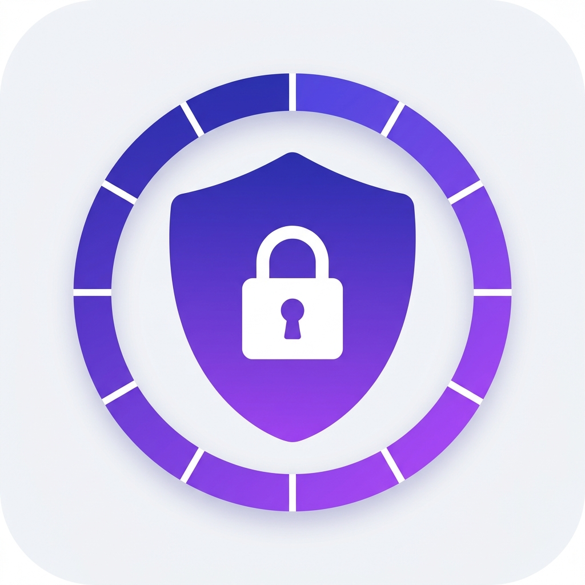
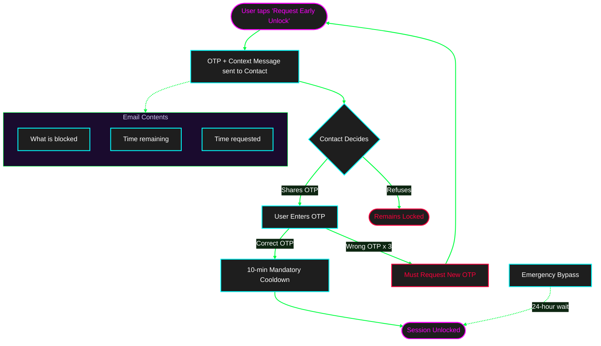
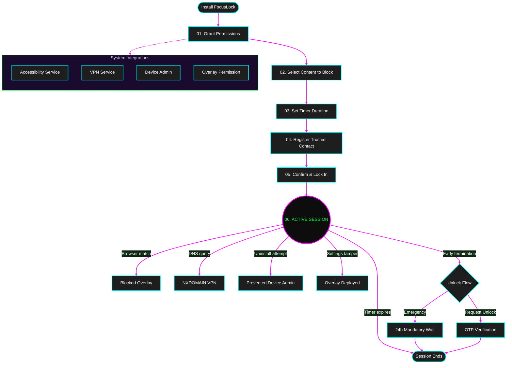
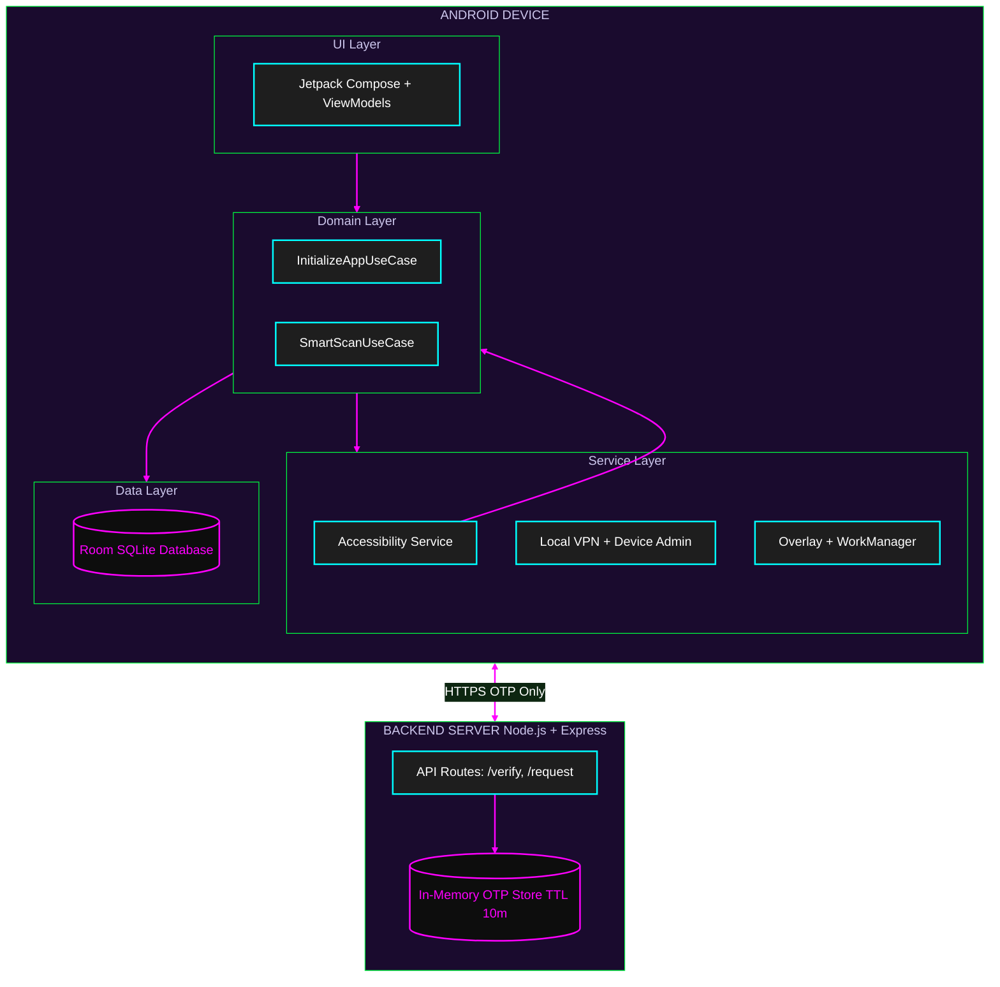

<p align="center">
  
</p>

<h1 align="center">
  <code>F O C U S L O C K</code>
</h1>

<p align="center">
  <code>[ SYSTEM ONLINE ]</code> — <strong>Digital discipline enforcer for Android</strong>
</p>

<p align="center">
  
  
  
  
</p>

<p align="center">
  
  
  
  
</p>

---

<p align="center">
  <code>▓▓▓▓▓▓▓▓▓▓▓▓▓▓▓▓▓▓▓▓▓▓▓▓▓▓▓▓▓▓▓▓▓▓▓▓▓▓▓▓▓▓▓▓▓▓▓▓▓▓▓▓</code><br/>
  <code>█  "Once you lock in, only someone you trust holds the key."  █</code><br/>
  <code>▓▓▓▓▓▓▓▓▓▓▓▓▓▓▓▓▓▓▓▓▓▓▓▓▓▓▓▓▓▓▓▓▓▓▓▓▓▓▓▓▓▓▓▓▓▓▓▓▓▓▓▓</code>
</p>

---

## 🧠 System Description

FocusLock is a **self-discipline Android app** that blocks distracting browser content for a set time period — and makes it **genuinely impossible** to undo alone.

**The core protocol:** Once you start a blocking session, **you cannot terminate it solo.**

Unlike other blocker apps where a single tap removes the block, FocusLock creates **real accountability** by requiring a trusted human contact to authorize early termination.

### Identify User

| Profile | Match |
|---------|-------|
| Android users aware of their distraction problem | `✅ MATCH` |
| People who need **external friction** to follow through | `✅ MATCH` |
| Has at least one trusted person willing to be an accountability partner | `✅ MATCH` |

---

## ✨ Core Modules

### 🔒 Keyword & Category Blocking

| Method | Mechanism | Engine |
|--------|-----------|--------|
| **Keyword Blocking** | Intercepts browser URLs containing custom keywords | `AccessibilityService` |
| **Domain Blocking** | Blocks entire domains by category via DNS interception | `Local VPN (TUN)` |

- ⚡ Works across **all installed browsers** (Chrome, Firefox, Brave, Opera, Edge, DuckDuckGo, Samsung, Kiwi, UC)
- ⚡ Up to **50 custom keywords** + 6 preset content categories
- ⚡ **Zero data exfiltration** — no browsing data leaves the device
- ⚡ **Smart Scan** — async metadata + DoH race for dynamic blocking

### ⏱️ Timer Lock

- Set blocking sessions from **15 minutes → 72 hours**
- Once activated, the session **cannot be stopped** until timer expires
- Timer persists across **app restarts, process death, and device reboots**
- **Device Admin API** prevents uninstallation during active sessions

### 🔐 Trusted Contact Unlock



### 🛡️ Settings Protection

During an active session, the app **blocks attempts** to:
- `[ BLOCKED ]` Disable the Accessibility Service
- `[ BLOCKED ]` Turn off the VPN
- `[ BLOCKED ]` Revoke Device Admin privileges
- `[ BLOCKED ]` Navigate to FocusLock settings in Android Settings

A **full-screen overlay** deploys when the user navigates to protected settings.

---

## 🌊 Execution Flow



---

## 🏗️ Architecture

FocusLock follows **MVVM + Clean Architecture** with strict layer separation:



### 🎯 Hotspots Scan

> Source: graphify-out (2346 nodes · 2122 edges · 404 communities)

| Node | Edges | Type | Blast Radius |
|------|-------|------|-------------|
| `SingletonCImpl` (Hilt) | 25 | Hub | `██████████ CRITICAL` |
| `ViewModelCImpl` (Hilt) | 21 | Hub | `█████████░ CRITICAL` |
| `BlockingRepository` | 19 | Hub | `█████████░ CRITICAL` |
| `BlockedDomainDao_Impl` | 17 | Hub | `████████░░ HIGH` |
| `FocusVpnService` | — | Hub | `████████░░ HIGH` |
| `OnboardingViewModel` | — | Hub | `███████░░░ HIGH` |
| `SmartScanUseCase` | — | Bridge | `███████░░░ HIGH` |
| `FocusAccessibilityService` | — | Bridge | `██████░░░░ MEDIUM` |
| `PermissionEnforcementService` | — | Bridge | `█████░░░░░ MEDIUM` |
| `PermissionChecker` | — | Bridge | `████░░░░░░ MEDIUM` |

---

## 🛠️ Tech Stack

### Android App

| Component | Technology | Justification |
|-----------|-----------|--------------|
| Language | `Kotlin 2.0+` | Modern Android standard |
| UI | `Jetpack Compose + Material 3` | Declarative, no XML |
| Architecture | `MVVM + Clean Architecture` | UI → ViewModel → UseCase → Repository |
| DI | `Hilt` | Official Android DI |
| Database | `Room (SQLite) + Kotlin Flow` | Reactive local storage |
| Networking | `Retrofit + OkHttp + Kotlin Serialization` | Type-safe HTTP |
| Background | `WorkManager` | Reliable across process death & reboot |
| Services | `AccessibilityService, VpnService, DeviceAdmin, PermissionEnforcementService` | Core blocking + permission health |
| Async | `Kotlin Coroutines only` | No RxJava, no callbacks |
| Testing | `JUnit 4 + MockK + Turbine` | Unit tests for UseCases & ViewModels |

### Backend Server

| Component | Technology | Justification |
|-----------|-----------|--------------|
| Runtime | `Node.js 20 LTS` | Low overhead |
| Framework | `Express 5` | Minimal HTTP |
| Language | `TypeScript 6` | Type safety |
| Email | `Brevo API` | Transactional email — OTP delivery to trusted contact |
| OTP Hashing | `bcrypt` | Secure — never stores plain OTPs |
| OTP Generation | `crypto.randomInt` | Cryptographically secure 6-digit codes |
| Validation | `Zod` | Schema-based request validation |
| Security | `Helmet + CORS` | HTTP hardening |
| Storage | `In-memory Map + TTL` | No database — OTPs expire in 10 min |
| Deploy | `Railway.app` | GitHub-triggered deploys, env var managed |

---

## 🗄️ Database Schema

All data is stored **locally on-device** using Room (SQLite). No user data is stored on the backend.

| Table | Purpose | Constraint |
|-------|---------|-----------|
| `sessions` | Current & past focus sessions | Only 1 `ACTIVE` at a time |
| `blocked_keywords` | User's custom keywords | Max 50, stored lowercase |
| `blocked_categories` | Preset content categories | 6 categories, toggled on/off |
| `blocked_domains` | Domain blocklist for VPN | 58,000+ rows, indexed |
| `trusted_contacts` | Verified trusted contact | Max 1 contact for MVP |
| `unlock_requests` | Early unlock attempts (audit trail) | Max 3 OTP attempts/request |
| `app_settings` | Key-value app config | Onboarding, permissions, `DOMAINS_SEEDED` |

---

## 🔌 API Endpoints

| Endpoint | Method | Purpose |
|----------|--------|---------|
| `/verify-contact` | `POST` | Send OTP to verify trusted contact email |
| `/confirm-contact` | `POST` | Verify the contact OTP |
| `/request-unlock` | `POST` | Send unlock OTP + context to trusted contact |
| `/verify-unlock-otp` | `POST` | Verify the unlock OTP |

**Privacy protocol:**
- `❌` No user accounts
- `❌` No browsing history stored
- `❌` No keywords/categories stored on server
- `✅` Emails held only during OTP verification, then discarded
- `✅` OTPs hashed with bcrypt, expire in 10 minutes

---

## 📱 Permissions Manifest

| Permission | Engine | If Denied |
|------------|--------|-----------|
| `BIND_ACCESSIBILITY_SERVICE` | Keyword detection | Keyword blocking disabled |
| `BIND_VPN_SERVICE` | DNS domain blocking | Domain blocking disabled |
| `BIND_DEVICE_ADMIN` | Uninstall prevention | Timer lock not enforced |
| `RECEIVE_BOOT_COMPLETED` | Session survives reboot | Session lost on reboot |
| `FOREGROUND_SERVICE` | Keep services alive | Services killed by OS |
| `SYSTEM_ALERT_WINDOW` | Blocking overlay | Overlay won't render |
| `REQUEST_IGNORE_BATTERY_OPTIMIZATIONS` | Prevent OEM service kill | Services killed after reboot |
| `INTERNET` | OTP via backend | Trusted contact disabled |

---

## 🚀 Quickstart

### Prerequisites

```
[ REQUIRED ] Android SDK (API 26+)
[ REQUIRED ] Node.js 20 LTS
[ REQUIRED ] Physical Android device (emulators cannot test VPN/Accessibility)
[ REQUIRED ] Brevo account (email delivery)
```

### 1. Clone

```bash
git clone https://github.com/Harshal-S-Bhoyar/FocuseLocker.git
cd FocuseLocker
```

### 2. Build Android App

```bash
# Set environment variable (Windows)
set ANDROID_HOME=C:\Users\<YOUR_USERNAME>\AndroidSDK

# Build debug APK
gradlew.bat assembleDebug

# Install on connected device
adb install -r app\build\outputs\apk\debug\app-debug.apk
```

### 3. Start Backend

```bash
cd backend
npm install
cp .env.example .env
```

Edit `.env`:
```env
BREVO_API_KEY=your_key_here
BREVO_SENDER_EMAIL=your_email@example.com
OTP_EXPIRY_MINUTES=10
OTP_MAX_ATTEMPTS=3
PORT=3000
```

```bash
npm run dev      # Development
npm test         # Run tests
npm run build    # Production build
```

### 4. Connect App ↔ Backend

| Build | URL | Source |
|-------|-----|-------|
| Debug | `http://127.0.0.1:3000` | ADB reverse proxy |
| Release | `https://focuslock-backend.railway.app` | Production |

```powershell
# ADB reverse tunnel (run when USB reconnects)
adb reverse tcp:3000 tcp:3000
```

> ⚠️ **"Failed to connect to server"** — Your ADB reverse tunnel died. Run `adb reverse --list` to verify, then re-run `adb reverse tcp:3000 tcp:3000`.

---

## 🧪 Tests

### Android
```bash
gradlew.bat testDebugUnitTest
# Reports: app/build/reports/tests/testDebugUnitTest/index.html
```

**Coverage:** ✅ All UseCases (19) · ✅ ViewModels · ✅ Repositories · ✅ Turbine flow tests · ✅ Coroutine test dispatchers

### Backend
```bash
cd backend && npm test
```

**Coverage:** ✅ OTP store ops · ✅ Zod schema validation · ✅ Supertest API integration

---

## 🔐 Security Audit

| Vector | Protection |
|--------|-----------|
| OTP Generation | `crypto.randomInt(100000, 999999)` — cryptographically secure |
| OTP Storage | Hashed with `bcrypt` — never plaintext |
| OTP Lifetime | 10 min max, deleted after use or max attempts |
| Contact Info | Emails stored locally on device only |
| Logging | Emails and OTPs **never logged**, even in debug |
| Network | All API calls over HTTPS |
| Backend URL | Read from `BuildConfig`, never hardcoded |
| Backend Storage | In-memory only — nothing persisted to disk |
| Session Integrity | `expires_at` timestamp is single source of truth |
| Uninstall Protection | Device Admin API active during sessions |
| Settings Protection | Overlay blocks Accessibility/VPN/Admin settings |
| SSRF Protection | `MetaDescriptionFetcher` validates URLs before fetching |
| DNS Recursion | `ProtectedSocketFactory` prevents VPN tunnel loops |

---

## 📁 Project Tree

```
FocuseLocker/
├── app/                              # Android application
│   └── src/main/java/com/focuslock/
│       ├── data/                     # Data layer
│       │   ├── local/
│       │   │   ├── dao/              # Room DAOs (7)
│       │   │   ├── entity/           # Room entities (7)
│       │   │   └── FocusDatabase.kt
│       │   ├── remote/
│       │   │   ├── api/              # Retrofit API interface
│       │   │   └── dto/              # Request/Response DTOs
│       │   ├── repository/           # Repository implementations
│       │   ├── session/              # SessionRuntimeController
│       │   └── parser/               # StevenBlackParser (hosts file)
│       ├── domain/                   # Domain layer (pure Kotlin)
│       │   ├── model/                # Domain models
│       │   └── usecase/              # 19+ UseCases
│       ├── service/                  # Android services
│       │   ├── accessibility/        # FocusAccessibilityService
│       │   ├── vpn/                  # FocusVpnService + VpnPacketLoop
│       │   ├── overlay/              # BlockingOverlayService
│       │   └── admin/                # FocusDeviceAdminReceiver
│       ├── ui/                       # Presentation layer
│       │   ├── onboarding/           # Onboarding + Permission screens
│       │   ├── setup/                # Category, Keyword, Timer screens
│       │   ├── session/              # Active session + Unlock screens
│       │   ├── navigation/           # Compose Navigation graph
│       │   ├── theme/                # Material 3 theme + CustomIcons
│       │   └── common/              # Shared composables
│       ├── worker/                   # WorkManager workers
│       ├── receiver/                 # BootReceiver
│       ├── di/                       # Hilt DI modules (3)
│       └── util/                     # PermissionChecker, FileLoggingTree
├── backend/                          # Node.js OTP server
│   ├── src/
│   │   ├── routes/                   # Express route handlers
│   │   ├── services/                 # OTP + Email services
│   │   ├── store/                    # In-memory OTP store
│   │   ├── schemas/                  # Zod validation
│   │   ├── middleware/               # Request validation
│   │   └── config/                   # Environment config
│   └── tests/                        # Jest test suite
├── Architectur/                      # Architecture documentation
├── projects/                         # Implementation plans
├── doc/                              # PRD, User Stories, System Design
└── Threat_Detection/                 # Security audit reports
```

---

## ⚠️ Known Limitations

| Limitation | Severity | Status |
|-----------|----------|--------|
| Factory reset bypasses all protections | `CRITICAL` | Accepted — cannot prevent on Android |
| OEM kills accessibility after reboot | `HIGH` | Mitigated — battery optimization + smart routing |
| Force stop kills services temporarily | `MEDIUM` | Foreground notification reduces risk |
| Contact can share OTP without thinking | `HIGH` | Context message in email encourages responsibility |
| Email delivery may hit spam | `MEDIUM` | 24h emergency bypass as fallback |
| ADB install resets accessibility | `LOW` | Development-only — not a production issue |

---

## 📋 Development Phases

| Phase | Focus | Status |
|-------|-------|--------|
| `PHASE_01` | Project setup, Hilt, Room, Retrofit boilerplate | `✅ COMPLETE` |
| `PHASE_02` | Onboarding, permissions, trusted contact | `✅ COMPLETE` |
| `PHASE_03` | Category/keyword selection, timer, session activation | `✅ COMPLETE` |
| `PHASE_04` | Accessibility Service, VPN Service, blocking overlay | `✅ COMPLETE` |
| `PHASE_05` | Device Admin, boot recovery, settings protection | `✅ COMPLETE` |
| `PHASE_06` | Unlock flow, OTP entry, cooldown, emergency bypass | `✅ COMPLETE` |
| `PHASE_07` | Performance optimization + reboot survival + PermissionEnforcementService | `✅ COMPLETE` |

---

## 📊 Codebase Stats

| Metric | Count |
|--------|-------|
| Total files (graphify) | 427 |
| Graph nodes | 2,346 |
| Graph edges | 2,122 |
| Graph communities | 404 |
| Kotlin source files | ~55 |
| TypeScript source files | ~12 |
| Domain UseCases | 22+ |
| Room DAOs | 7 |
| Room Entities | 7 |
| Repository implementations | 5 |
| Compose screens | 12+ |
| ViewModels | 10+ |
| Unit tests | 30+ |
| Hilt DI modules | 3 |
| Android services | 5 (incl. PermissionEnforcementService) |
| WorkManager workers | 4 |
| Backend API endpoints | 4 |

---

## 🤝 Contributing

1. Fork the repository
2. Create a feature branch (`git checkout -b feature/your-feature`)
3. Follow coding rules in `doc/6_CONTEXT_AND_RULES.md`
4. Write unit tests for any new UseCase or ViewModel
5. Test on a **physical Android device**
6. Submit a pull request

### 📜 Coding Rules

```
[ RULE ] Kotlin only — no Java files
[ RULE ] No `!!` — handle nulls with ?. / ?: / requireNotNull()
[ RULE ] No business logic in Composables — delegate to ViewModel
[ RULE ] No business logic in ViewModels — delegate to UseCases
[ RULE ] All DAO reads return Flow<T> — reactive, not one-shot
[ RULE ] No runBlocking in production code
[ RULE ] Never log emails or OTPs — not even in debug
[ RULE ] Hilt for all DI — no manual dependency passing
```

---

## 📄 Documentation

| Document | Description |
|----------|-------------|
| [`doc/1_PRD.md`](doc/1_PRD.md) | Product Requirements Document |
| [`doc/2_USER_STORIES.md`](doc/2_USER_STORIES.md) | User Stories + acceptance criteria |
| [`doc/3_SYSTEM_DESIGN.md`](doc/3_SYSTEM_DESIGN.md) | System architecture & data flows |
| [`doc/4_DATA_MODEL.md`](doc/4_DATA_MODEL.md) | Database schema & entity relationships |
| [`doc/5_TECH_STACK.md`](doc/5_TECH_STACK.md) | Technology choices & folder structure |
| [`doc/6_CONTEXT_AND_RULES.md`](doc/6_CONTEXT_AND_RULES.md) | AI context & coding rules |
| [`Architectur/architecture.md`](Architectur/architecture.md) | Low-level architectural layout |

---

## 🗺️ Roadmap

```
[ ] iOS version
[ ] Multiple trusted contacts
[ ] Usage analytics & session history reports
[ ] Scheduled recurring sessions
[ ] Browser extension companion
[ ] Parental control mode
[ ] Web dashboard
[ ] OEM-specific battery optimization intents (Xiaomi AutoStart, Samsung Power)
```

---

<p align="center">
  <code>▓▓▓▓▓▓▓▓▓▓▓▓▓▓▓▓▓▓▓▓▓▓▓▓▓▓▓▓▓▓▓▓▓▓▓▓▓▓▓▓▓▓▓▓▓▓▓▓▓▓▓▓</code><br/>
  <code>█      Built with focus, for focus.                        █</code><br/>
  <code>█  Because sometimes, you need someone else to hold the key █</code><br/>
  <code>▓▓▓▓▓▓▓▓▓▓▓▓▓▓▓▓▓▓▓▓▓▓▓▓▓▓▓▓▓▓▓▓▓▓▓▓▓▓▓▓▓▓▓▓▓▓▓▓▓▓▓▓</code>
</p>
