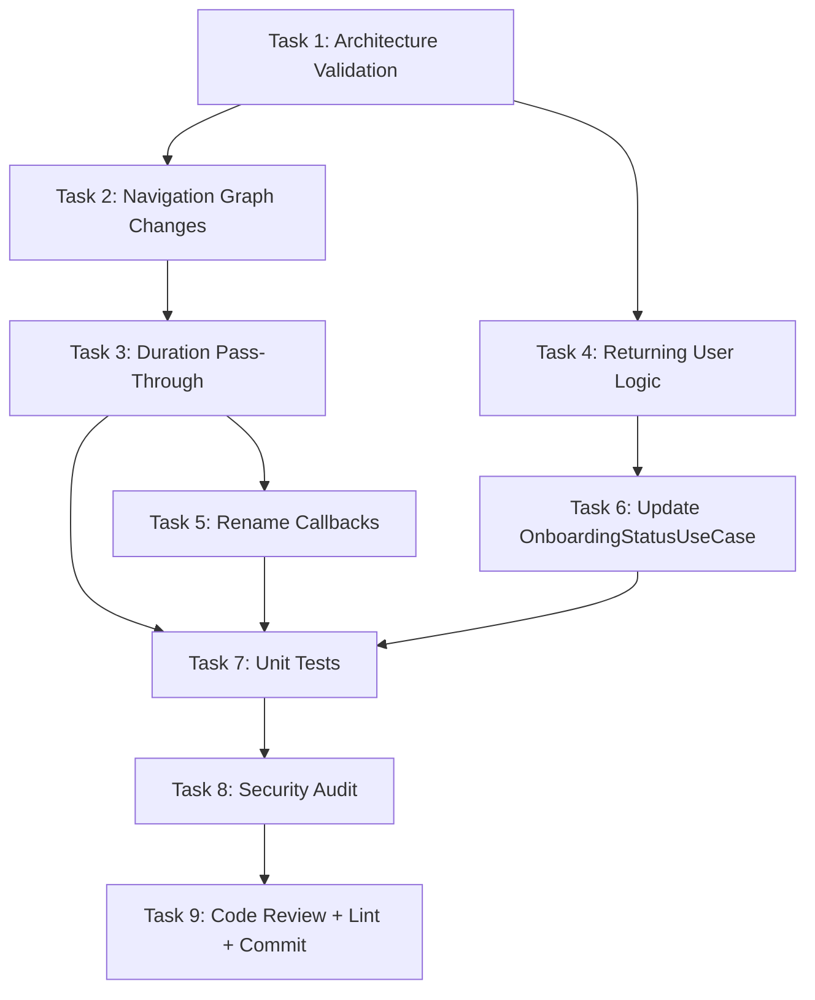

# OTP Flow Reorder Plan — Move Trusted Contact Setup After Timer Setup
## FocusLock — Navigation Flow Fix
## Created: 2026-06-02

---

> [!IMPORTANT]
> The Trusted Contact + OTP verification flow currently appears immediately after permission setup (Phase 2), **before** the user picks keywords or sets a timer. Per the user's request, it should appear **after** the timer setup and **before** session activation. This plan fixes the navigation order without breaking any existing functionality.

---

## Problem Statement

### Current (Broken) Flow
```
Onboarding → Permissions → TrustedContactSetup → VerifyContact(OTP) → CategorySelection → KeywordSelection → TimerSetup → SessionConfirmation → ActiveSession
```

### Desired Flow (User's Request)
```
Onboarding → Permissions → CategorySelection → KeywordSelection → TimerSetup → TrustedContactSetup → VerifyContact(OTP) → SessionConfirmation → ActiveSession
```

The OTP feature should appear **after** keyword entry and timer setup, **before** the final session confirmation — not at the initial onboarding phase.

---

## Root Cause Analysis

Looking at [AppNavigation.kt](file:///c:/Users/harshal.bhoyar/Project/FocuseLocker/app/src/main/java/com/focuslock/ui/navigation/AppNavigation.kt):

| Line | Current Wiring | Issue |
|---|---|---|
| 70–74 | `PermissionSetup` → navigates to `TrustedContactSetup` | ❌ Should navigate to `CategorySelection` instead |
| 77–83 | `TrustedContactSetup` → navigates to `VerifyContact` | ✅ Correct (these two stay paired) |
| 85–94 | `VerifyContact` → navigates to `CategorySelection` | ❌ Should navigate to `SessionConfirmation` instead |
| 106–112 | `KeywordSelection` → navigates to `TimerSetup` | ✅ Correct |
| 114–120 | `TimerSetup` → navigates to `SessionConfirmation` | ❌ Should navigate to `TrustedContactSetup` instead |

The fix requires **4 navigation callback changes** in a single file. No new screens, no new UseCases, no schema changes.

---

## Agent Roster (per Master.md)

| Agent | Role | Why |
|---|---|---|
| **Architect Agent** | Validate the flow change is safe, no side effects | Rule A1 — always first for any feature change |
| **Android Compose Agent** | Modify `AppNavigation.kt` navigation callbacks | Primary agent for navigation graph |
| **Domain Agent** | Verify `CheckOnboardingStatusUseCase` still works | The onboarding status check may need adjusting |
| **Security Agent** | Review that OTP flow is not bypassed after reordering | Rule A3 — OTP logic is security-sensitive |
| **Testing Agent** | Update affected unit tests | Rule A5 — tests must pass |
| **Code Reviewer Agent** | Final review before commit | Rule A4 — mandatory |

---

## Skill Invocation Map (per 7_RULES.md)

| Phase | Skills (invoke in order) | Rule |
|---|---|---|
| **Start** | `@brainstorming` → `@concise-planning` | R1 |
| **Navigation Graph Change** | `@mobile-developer` | R2 |
| **Architecture Decision** | `@software-architecture` → `@architecture` | R4 |
| **Compose UI Wiring** | `@mobile-design` | R11 |
| **Security Review** | `@mobile-security-coder` | R10 |
| **Tests** | `@test-driven-development` → `@testing-patterns` → `@kotlin-coroutines-expert` | R12 |
| **Code Review** | `@uncle-bob-craft` → `@production-code-audit` | R14 |
| **Lint** | `@lint-and-validate` | R15 |
| **Commit** | `@git-pushing` | R16 |

### Enforcement Rules Applicable
- **E1:** Trusted Contact touches session state — `@mobile-security-coder` must be active
- **E5:** Any changed UseCase or ViewModel must have at least one passing unit test
- **E4:** Lint before commit

---

## Impact Analysis

### Files That MUST Change

| File | Change Type | Risk |
|---|---|---|
| [AppNavigation.kt](file:///c:/Users/harshal.bhoyar/Project/FocuseLocker/app/src/main/java/com/focuslock/ui/navigation/AppNavigation.kt) | Modify 4 navigation callbacks + add route arguments | 🟡 Medium |

### Files That MAY Need Change

| File | Change Type | Risk |
|---|---|---|
| [CheckOnboardingStatusUseCase.kt](file:///c:/Users/harshal.bhoyar/Project/FocuseLocker/app/src/main/java/com/focuslock/domain/usecase/CheckOnboardingStatusUseCase.kt) | Review — does onboarding completion still gate correctly? | 🟡 Medium |
| [PermissionSetupScreen.kt](file:///c:/Users/harshal.bhoyar/Project/FocuseLocker/app/src/main/java/com/focuslock/ui/onboarding/PermissionSetupScreen.kt) | Rename `onNavigateToTrustedContact` → `onNavigateNext` | 🟢 Low |
| [TrustedContactSetupScreen.kt](file:///c:/Users/harshal.bhoyar/Project/FocuseLocker/app/src/main/java/com/focuslock/ui/onboarding/TrustedContactSetupScreen.kt) | Accept and forward `durationMillis` route argument | 🟡 Medium |
| [VerifyContactScreen.kt](file:///c:/Users/harshal.bhoyar/Project/FocuseLocker/app/src/main/java/com/focuslock/ui/onboarding/VerifyContactScreen.kt) | Accept and forward `durationMillis` route argument; change destination | 🟡 Medium |
| [TimerSetupViewModel.kt](file:///c:/Users/harshal.bhoyar/Project/FocuseLocker/app/src/main/java/com/focuslock/ui/setup/TimerSetupViewModel.kt) | Add "has verified contact?" check for returning users | 🟡 Medium |
| Unit test files for navigation/ViewModels | Update expected navigation targets | 🟢 Low |

### Files That Do NOT Change

| File | Why |
|---|---|
| All DAOs, entities, repositories | No schema or data changes |
| Backend (Node.js) | No backend changes |
| All services (Accessibility, VPN, DeviceAdmin) | No service changes |
| `CategorySelectionScreen.kt` | Screen itself is unchanged |
| `KeywordSelectionScreen.kt` | Screen itself is unchanged |
| `SessionConfirmationScreen.kt` | Screen itself is unchanged |

---

## Task Breakdown — Build Order

### Task 1 — Architecture Validation
**Agent:** Architect Agent
**Skills:** `@brainstorming` → `@concise-planning` → `@software-architecture`
**Priority:** 🔴 Critical — must confirm before any code change

**Verify these invariants hold after reordering:**

- [ ] User CANNOT reach `SessionConfirmation` without a verified trusted contact
- [ ] `CheckOnboardingStatusUseCase` correctly determines if user has completed onboarding
- [ ] First-time vs returning user flow both work with the new order
- [ ] If user already verified a contact in a previous session, they should not be forced to re-verify every time

**Key Decision: First-Time vs Returning User**

| Scenario | Behavior |
|---|---|
| First launch (no contact) | Full flow: `Permissions → Categories → Keywords → Timer → TrustedContact → Verify → Confirm` |
| Returning user (contact already verified) | Short flow: `Categories → Keywords → Timer → Confirm` (skip contact setup) |
| User wants to change contact | Available in settings or before session, outside active session (per US-02) |

---

### Task 2 — Modify Navigation Graph (Core Fix)
**Agent:** Android Compose Agent
**Skills:** `@mobile-developer` → `@mobile-design`
**Priority:** 🔴 Critical
**File:** [AppNavigation.kt](file:///c:/Users/harshal.bhoyar/Project/FocuseLocker/app/src/main/java/com/focuslock/ui/navigation/AppNavigation.kt)

**4 exact changes needed:**

#### Change 2.1 — `PermissionSetup` → `CategorySelection` (line 70–74)
```diff
 composable(Screen.PermissionSetup.route) {
     PermissionSetupScreen(
         onNavigateToTrustedContact = {
-            navController.navigate(Screen.TrustedContactSetup.route)
+            navController.navigate(Screen.CategorySelection.route)
         }
     )
 }
```

#### Change 2.2 — `TimerSetup` → `TrustedContactSetup` (line 114–120)
```diff
 composable(Screen.TimerSetup.route) {
     TimerSetupScreen(
         onNavigateNext = { durationMillis ->
-            navController.navigate(Screen.SessionConfirmation.route + "/$durationMillis")
+            navController.navigate(Screen.TrustedContactSetup.route + "/$durationMillis")
         }
     )
 }
```

#### Change 2.3 — `VerifyContact` → `SessionConfirmation` (line 85–94)
```diff
 composable(Screen.VerifyContact.route) {
     VerifyContactScreen(
         onNavigateToSetup = {
-            navController.navigate(Screen.CategorySelection.route) {
-                popUpTo(Screen.Onboarding.route) { inclusive = true }
+            navController.navigate(Screen.SessionConfirmation.route + "/$durationMillis") {
+                popUpTo(Screen.CategorySelection.route) { inclusive = true }
             }
         }
     )
 }
```

#### Change 2.4 — Add route arguments to `TrustedContactSetup` and `VerifyContact`
Add `/{durationMillis}` as a navigation argument to both composables so the timer value passes through.

---

### Task 3 — Duration Pass-Through Mechanism
**Agent:** Android Compose Agent + Domain Agent
**Skills:** `@mobile-developer` → `@kotlin-coroutines-expert` → `@software-architecture`
**Priority:** 🔴 Critical

The `durationMillis` value is currently passed from `TimerSetup` → `SessionConfirmation`. With the new flow:

```
TimerSetup → TrustedContactSetup → VerifyContact → SessionConfirmation
```

**Recommended approach: Route arguments (simplest, most explicit)**

**Files to modify:**
- `AppNavigation.kt` — add `/{durationMillis}` to `TrustedContactSetup` and `VerifyContact` routes
- `TrustedContactSetupScreen.kt` — accept `durationMillis` param, forward on navigate
- `VerifyContactScreen.kt` — accept `durationMillis` param, forward on navigate

**Example route definition:**
```kotlin
composable(
    route = Screen.TrustedContactSetup.route + "/{durationMillis}",
    arguments = listOf(navArgument("durationMillis") { type = NavType.LongType })
) { backStackEntry ->
    val durationMillis = backStackEntry.arguments?.getLong("durationMillis") ?: 0L
    TrustedContactSetupScreen(
        onNavigateToVerify = {
            navController.navigate(Screen.VerifyContact.route + "/$durationMillis")
        }
    )
}
```

---

### Task 4 — Returning User Logic (Skip Contact If Already Verified)
**Agent:** Domain Agent + Android Compose Agent
**Skills:** `@mobile-developer` → `@kotlin-coroutines-expert`
**Priority:** 🟡 High

**New UseCase:**

```kotlin
// domain/usecase/HasVerifiedContactUseCase.kt
class HasVerifiedContactUseCase @Inject constructor(
    private val trustedContactRepository: TrustedContactRepository
) {
    suspend operator fun invoke(): Boolean {
        return trustedContactRepository.getVerifiedContact() != null
    }
}
```

**Integration in navigation or `TimerSetupViewModel`:**
- When user taps "Next" on Timer Setup:
  - If verified contact exists → navigate to `SessionConfirmation`
  - If no verified contact → navigate to `TrustedContactSetup`

This ensures returning users don't repeat OTP verification every session.

---

### Task 5 — Rename Misleading Callbacks (Polish)
**Agent:** Android Compose Agent
**Skills:** `@mobile-developer`
**Priority:** 🟢 Low — cosmetic but improves code clarity

| File | Old Callback Name | New Callback Name |
|---|---|---|
| `PermissionSetupScreen.kt` | `onNavigateToTrustedContact` | `onNavigateNext` |
| `VerifyContactScreen.kt` | `onNavigateToSetup` | `onNavigateToSessionConfirmation` |

---

### Task 6 — Update `CheckOnboardingStatusUseCase`
**Agent:** Domain Agent
**Skills:** `@mobile-developer` → `@kotlin-coroutines-expert`
**Priority:** 🟡 High

The `CheckOnboardingStatusUseCase` determines what screen to show on app launch. After reordering:

- **If no permissions granted:** Show `Onboarding` → `PermissionSetup`
- **If permissions granted but no session history:** Show `CategorySelection` (start the setup flow)
- **If active session exists:** Show `ActiveSession`
- **If active session with OTP pending:** Show the appropriate unlock screen

Review the existing logic to ensure it doesn't assume "contact verified = onboarding complete" in a way that breaks the new order. Specifically:
- Onboarding should be "complete" once permissions are granted (contact verification moves to the session setup flow)
- The trusted contact check should NOT block entry to the category selection screen

---

### Task 7 — Unit Tests
**Agent:** Testing Agent
**Skills:** `@test-driven-development` → `@testing-patterns` → `@kotlin-coroutines-expert`
**Priority:** 🔴 Critical (Rule E5)

| Test File | Key Cases |
|---|---|
| `TimerSetupViewModelTest.kt` | Verify navigation to `TrustedContactSetup` when no contact exists; navigation to `SessionConfirmation` when contact exists |
| `HasVerifiedContactUseCaseTest.kt` (NEW) | Returns true when verified contact in DB; returns false when empty |
| `CheckOnboardingStatusUseCaseTest.kt` | Update expected flow if onboarding status logic changed |
| Navigation integration test (manual) | Full flow on real device |

---

### Task 8 — Security Audit
**Agent:** Security Agent
**Skills:** `@mobile-security-coder` → `@api-security-best-practices`
**Priority:** 🔴 Critical (Rule A3)

**Mandatory checks:**
- [ ] User CANNOT bypass trusted contact verification and still start a session
- [ ] `SessionConfirmation` still validates that a verified contact exists before allowing "Lock In"
- [ ] OTP flow is unchanged — only its position in the navigation graph moved
- [ ] No phone numbers or OTPs exposed in route arguments (`durationMillis` is the only route arg)
- [ ] Returning user skip-logic cannot be exploited to start session without contact

---

### Task 9 — Code Review + Lint + Commit
**Agent:** Code Reviewer Agent
**Skills:** `@uncle-bob-craft` → `@production-code-audit` → `@lint-and-validate` → `@git-pushing`
**Priority:** 🟡 High (Rules E4, E6)

**Review checklist:**
- [ ] No `!!` in modified code
- [ ] No business logic in Composable functions
- [ ] Clean Architecture boundaries intact
- [ ] All affected tests pass
- [ ] `./gradlew testDebugUnitTest lintDebug assembleDebug` passes clean
- [ ] Commit message: `[FIX] Reorder OTP flow — trusted contact setup after timer, before session confirmation`

---

## Implementation Order (Dependency Graph)



**Parallel tracks:**
- Track A: Task 2 → Task 3 → Task 5 (navigation changes)
- Track B: Task 4 → Task 6 (domain logic)
- Merge: Task 7 → Task 8 → Task 9

---

## Risk Matrix

| Risk | Impact | Mitigation |
|---|---|---|
| `durationMillis` lost between screens | 🔴 High — session can't start | Use route arguments — explicit and debuggable |
| Returning user bypasses contact verification | 🔴 High — session without safety net | `SessionConfirmationViewModel` validates contact exists before "Lock In" |
| `CheckOnboardingStatusUseCase` routes to wrong screen | 🟡 Medium — bad first-launch UX | Unit test all status → screen mappings |
| Callback name confusion after partial rename | 🟢 Low — code readability | Task 5 handles cleanup; non-blocking |
| Route argument string mismatch | 🟡 Medium — crash on navigation | Use constant route patterns; test manually |

---

## Estimated Effort

| Task | Effort |
|---|---|
| Task 1 — Architecture Validation | 15 min |
| Task 2 — Navigation Graph Changes | 30 min |
| Task 3 — Duration Pass-Through | 30 min |
| Task 4 — Returning User Logic | 30 min |
| Task 5 — Rename Callbacks | 15 min |
| Task 6 — Update OnboardingStatusUseCase | 20 min |
| Task 7 — Unit Tests | 45 min |
| Task 8 — Security Audit | 20 min |
| Task 9 — Code Review + Lint + Commit | 15 min |
| **Total** | **~3.5 hours** |

---

## New Navigation Flow Summary

### First-Time User (No Verified Contact)
```
Onboarding
  → PermissionSetup
    → CategorySelection
      → KeywordSelection
        → TimerSetup
          → TrustedContactSetup    ← OTP appears HERE now
            → VerifyContact
              → SessionConfirmation
                → ActiveSession
```

### Returning User (Contact Already Verified)
```
CategorySelection
  → KeywordSelection
    → TimerSetup
      → SessionConfirmation        ← Skips contact setup
        → ActiveSession
```

### Active Session User (On App Relaunch)
```
ActiveSession (directly)
```

---

## Coding Convention Reminders (from 6_CONTEXT_AND_RULES.md)

- ❌ No `!!` anywhere in Kotlin code
- ❌ No logic in Composable functions — delegate to ViewModel
- ❌ No business logic in ViewModels — only state and UseCase delegation
- ✅ All DAO reads return `Flow<T>`
- ❌ No `runBlocking` in production code
- ❌ Never log phone numbers or OTPs even in debug builds
- ✅ Backend URL must come from `BuildConfig`
- ✅ Coroutines only for async
- ✅ Hilt for all DI
