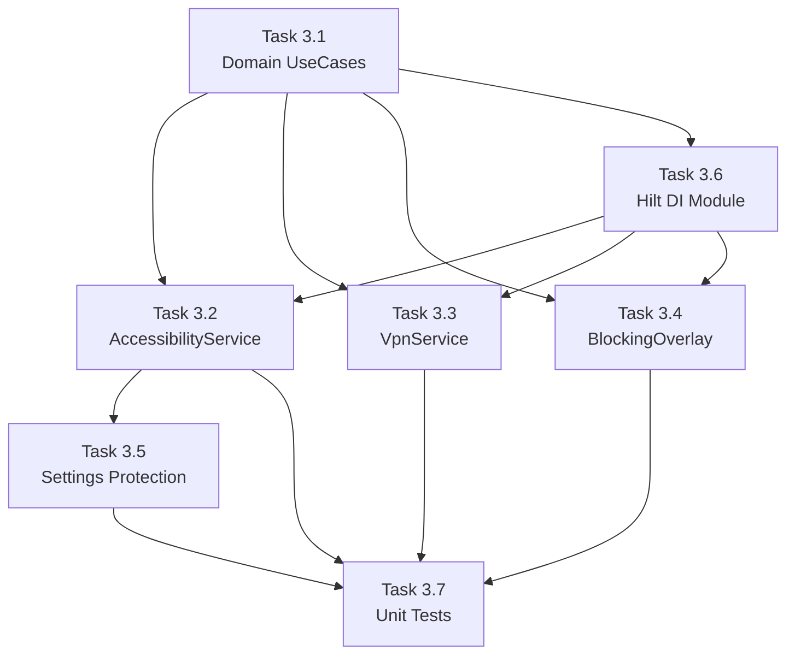

# Phase 3 — Core Blocking Services: Implementation Plan
## FocusLock Android App

---

> [!IMPORTANT]
> **Phase 3 is the heart of FocusLock.** Everything the user experiences as "blocking" comes from these four deliverables. If Phase 3 is wrong, the app's entire value proposition fails.

---

## 🎯 Phase 3 Objective

Implement the three core technical mechanisms that make FocusLock work:
1. **Accessibility Service** — reads browser URLs, detects keyword matches
2. **Local VPN Service** — intercepts DNS, blocks domains by category
3. **Blocking Overlay** — full-screen "blocked" screen the user cannot dismiss
4. **Settings Protection** — prevents user from disabling services via system Settings

---

## 📊 Current State Assessment

### ✅ What Already Exists (from Phase 1 & 2)

| Component | Status | Location |
|---|---|---|
| Room DB — all 7 entities + DAOs | ✅ Done | `data/local/entity/`, `data/local/dao/` |
| Domain models (Session, BlockedKeyword, BlockedCategory, etc.) | ✅ Done | `domain/model/` |
| Repository interfaces + implementations | ✅ Done | `domain/repository/`, `data/repository/` |
| `BlockingRepository` — keyword & domain queries | ✅ Done | Provides `getActiveKeywords()`, `getActiveBlockedDomains()` |
| `SessionRepository` — active session queries | ✅ Done | Provides `getActiveSession()`, `hasActiveSession()` |
| `accessibility_service_config.xml` | ✅ Done | Targets 10 browsers, listens to `typeWindowContentChanged` + `typeWindowStateChanged` |
| `device_admin.xml` | ✅ Done | `res/xml/` |
| `AndroidManifest.xml` — all services declared | ✅ Done | Services, receivers, permissions |
| Placeholder classes | ✅ Scaffolded | Empty shells — no real logic |

### ❌ What Needs to Be Built (This Phase)

| Component | Current State |
|---|---|
| `FocusAccessibilityService` | Empty shell — no URL extraction, no keyword matching, no overlay trigger |
| `FocusVpnService` | Empty shell — no TUN interface, no DNS interception |
| `BlockingOverlayService` | Empty shell — no overlay window, no UI |
| `BlockingOverlayScreen.kt` (Compose) | ❌ Does not exist |
| Settings screen protection | ❌ Not implemented |
| Domain use cases for blocking | ❌ Not created |
| Unit tests | ❌ Not created |

---

## 🏗️ Task Breakdown — Build Order

> [!NOTE]
> Tasks are ordered by dependency. Each task feeds into the next. Do not skip ahead.

---

### Task 3.1 — Domain Layer: Blocking Use Cases
**Agent:** Domain Agent  
**Priority:** 🔴 Critical — everything else depends on this  
**Reference:** `3_SYSTEM_DESIGN.md` Section 5, `4_DATA_MODEL.md` Section 1.2–1.4

**Files to create:**
```
domain/usecase/GetActiveKeywordsUseCase.kt
domain/usecase/GetActiveBlockedDomainsUseCase.kt
domain/usecase/CheckUrlForBlockedContentUseCase.kt
domain/usecase/IsSessionActiveUseCase.kt
```

**Responsibilities:**
| Use Case | Input | Output | Logic |
|---|---|---|---|
| `GetActiveKeywordsUseCase` | None | `Flow<List<String>>` | Returns active keywords as lowercase strings from `BlockingRepository` |
| `GetActiveBlockedDomainsUseCase` | None | `List<String>` | Returns blocked domains (joined with active categories) from `BlockingRepository` |
| `CheckUrlForBlockedContentUseCase` | `url: String` | `BlockCheckResult` (Blocked/Allowed) | Extracts domain + query params, checks against keyword list AND domain list |
| `IsSessionActiveUseCase` | None | `Boolean` | Delegates to `SessionRepository.hasActiveSession()` |

**Domain model to create:**
```kotlin
// domain/model/BlockCheckResult.kt
sealed class BlockCheckResult {
    data class Blocked(val matchedTerm: String, val reason: BlockReason) : BlockCheckResult()
    object Allowed : BlockCheckResult()
}

enum class BlockReason { KEYWORD_MATCH, DOMAIN_BLOCKED }
```

**Rules:**
- ❌ No Android imports allowed
- ✅ Pure Kotlin + coroutines only
- ✅ Case-insensitive matching (keywords stored lowercase, URL lowercased before comparison)
- ✅ URL matching includes query parameters (e.g., `google.com/search?q=gambling+tips`)

**Acceptance criteria:**
- [ ] `CheckUrlForBlockedContentUseCase` correctly identifies keyword in URL query params
- [ ] `CheckUrlForBlockedContentUseCase` correctly identifies blocked domain
- [ ] Returns `Allowed` when URL matches neither keywords nor domains
- [ ] All use cases are injectable via Hilt `@Inject constructor`

---

### Task 3.2 — FocusAccessibilityService: URL Extraction + Keyword Matching
**Agent:** Accessibility Agent (primary) + Security Agent (mandatory review)  
**Priority:** 🔴 Critical — this is the core blocking mechanism  
**Reference:** `3_SYSTEM_DESIGN.md` Section 2.2, Data Flow Section 5, `2_USER_STORIES.md` US-07

**File:** `service/accessibility/FocusAccessibilityService.kt`

**Responsibilities (step by step):**

```
1. onAccessibilityEvent() receives TYPE_WINDOW_CONTENT_CHANGED / TYPE_WINDOW_STATE_CHANGED
2. Filter: only process events from known browser package names
3. Extract URL text from the browser's address bar node
   - Traverse the accessibility node tree
   - Find the node with resource-id matching known browser URL bar IDs
   - Read the text content of that node
4. Pass extracted URL to CheckUrlForBlockedContentUseCase
5. If result is Blocked:
   a. Start BlockingOverlayService with the matched term + time remaining
   b. Perform ACTION_BACK on the browser to stop page load
6. If result is Allowed: do nothing
```

**Browser URL bar resource IDs (known):**
```
com.android.chrome          → "com.android.chrome:id/url_bar"
                            → "com.android.chrome:id/omnibox_text_field" (newer Chrome)
org.mozilla.firefox         → "org.mozilla.firefox:id/mozac_browser_toolbar_url_view"
com.brave.browser           → "com.brave.browser:id/url_bar"
com.opera.browser           → "com.opera.browser:id/url_field"
com.opera.mini.native       → "com.opera.mini.native:id/url_field"
com.duckduckgo.mobile.android → "com.duckduckgo.mobile.android:id/omnibarTextInput"
com.microsoft.emmx          → "com.microsoft.emmx:id/url_bar"
com.kiwibrowser.browser     → "com.kiwibrowser.browser:id/url_bar"
com.sec.android.app.sbrowser → "com.sec.android.app.sbrowser:id/location_bar_edit_text"
com.UCMobile.intl           → "com.UCMobile.intl:id/address_editor_with_progress"
```

**Key architecture decisions:**
- ❌ Do NOT inject Hilt into AccessibilityService (Hilt doesn't support it natively)
- ✅ Use `EntryPointAccessors.fromApplication()` to access the Hilt dependency graph
- ✅ Cache keyword list in memory on service start, refresh via Flow collector
- ✅ Debounce URL checks — same URL within 500ms should not trigger again
- ✅ Run keyword matching on `Dispatchers.Default` (CPU-heavy for large lists)

**Acceptance criteria (from US-07):**
- [ ] Detects URL changes in Chrome, Firefox, Brave (minimum 3 browsers)
- [ ] Matching done against full URL string including query parameters
- [ ] On match, full-screen overlay appears immediately
- [ ] Browser does not load the page (ACTION_BACK performed)

---

### Task 3.3 — FocusVpnService: Local DNS Interception
**Agent:** VPN Agent (primary) + Security Agent (mandatory review)  
**Priority:** 🔴 Critical — blocks domains that keywords can't catch  
**Reference:** `3_SYSTEM_DESIGN.md` Section 2.3, `2_USER_STORIES.md` US-08

**File:** `service/vpn/FocusVpnService.kt`

**Responsibilities (step by step):**

```
1. onStartCommand() → Build TUN interface via VpnService.Builder
2. Configure TUN:
   - addAddress("10.0.0.2", 32)       // Virtual IP for the TUN device
   - addRoute("0.0.0.0", 0)            // Route all traffic through TUN
   - addDnsServer("8.8.8.8")           // Upstream DNS (Google)
   - setSession("FocusLock VPN")
   - setMtu(1500)
3. Start packet reading loop on a background thread/coroutine:
   a. Read IP packet from TUN file descriptor
   b. Parse packet — check if it's a UDP DNS query (port 53)
   c. If DNS query:
      - Extract queried domain name from DNS payload
      - Check domain against blocked domain HashSet (loaded from Room)
      - If BLOCKED: craft an NXDOMAIN response, write back to TUN
      - If ALLOWED: forward to upstream DNS, read response, write back to TUN
   d. If NOT DNS: forward packet unchanged (passthrough)
4. onDestroy() → close TUN file descriptor, clean up
```

**Key architecture decisions:**
- ✅ Load blocked domains into a `HashSet<String>` on service start for O(1) lookup
- ✅ Use `EntryPointAccessors.fromApplication()` for Hilt access (same as Accessibility)
- ✅ DNS packet parsing is custom — no external library needed for MVP
- ✅ Use `ParcelFileDescriptor` from `VpnService.Builder.establish()`
- ❌ Do NOT inspect HTTPS payload — domain-level blocking only
- ❌ No external VPN server — everything on-device

**Helper files to create:**
```
service/vpn/DnsPacketParser.kt    — parse DNS query bytes, extract domain name
service/vpn/DnsResponseBuilder.kt — build NXDOMAIN response bytes
service/vpn/VpnPacketLoop.kt      — main read/write loop (coroutine)
```

**Acceptance criteria (from US-08):**
- [ ] VPN intercepts DNS queries
- [ ] Blocked domain list covers all selected active categories
- [ ] Blocked domains return NXDOMAIN (browser shows connection error)
- [ ] Non-blocked traffic passes through unchanged
- [ ] Works regardless of which browser is used

---

### Task 3.4 — BlockingOverlayService: Full-Screen Overlay
**Agent:** Android Compose Agent  
**Priority:** 🟡 High — the visible blocking mechanism  
**Reference:** `3_SYSTEM_DESIGN.md` Section 2.7, `2_USER_STORIES.md` US-07 & US-09

**Files to create/modify:**
```
service/overlay/BlockingOverlayService.kt  — modify existing
ui/overlay/BlockingOverlayScreen.kt        — create new (Compose)
```

**BlockingOverlayService responsibilities:**
```
1. onStartCommand() receives intent with:
   - matchedTerm: String (what was blocked)
   - blockReason: String (KEYWORD_MATCH or DOMAIN_BLOCKED)
   - timeRemainingMillis: Long
2. Create TYPE_APPLICATION_OVERLAY window using WindowManager
3. Inflate a ComposeView with BlockingOverlayScreen composable
4. Add the view as overlay window — covers entire screen
5. FLAG_NOT_FOCUSABLE + FLAG_LAYOUT_IN_SCREEN to ensure full coverage
6. Override onBackPressed equivalent — do NOT dismiss during active session
7. Provide a "Return to FocusLock" button that opens the main activity
8. Provide a "Request early unlock" button that navigates to unlock flow
9. Auto-dismiss after 5 seconds if user navigates away from blocked content
```

**BlockingOverlayScreen (Compose) shows:**
```
- 🚫 Large "Content Blocked" heading
- "Blocked: [keyword or domain]"
- "Reason: Keyword match / Domain blocked"
- "Time remaining: Xh Ym"
- [Return to FocusLock] button
- [Request Early Unlock] button
```

**Key architecture decisions:**
- ✅ Requires `SYSTEM_ALERT_WINDOW` permission (already declared in manifest)
- ✅ Run as foreground service with notification
- ✅ Use `WindowManager.LayoutParams.TYPE_APPLICATION_OVERLAY`
- ❌ Cannot be dismissed by back button during active session
- ✅ Auto-dismiss logic handled by the AccessibilityService (when URL changes to allowed content)

**Acceptance criteria (from US-07 & US-09):**
- [ ] Overlay shows what was blocked and time remaining
- [ ] Overlay shows option to request unlock
- [ ] Overlay cannot be dismissed by back button
- [ ] Overlay covers the entire screen

---

### Task 3.5 — Settings Screen Protection
**Agent:** Accessibility Agent  
**Priority:** 🟡 High — prevents circumvention  
**Reference:** `2_USER_STORIES.md` US-09

**File:** `service/accessibility/FocusAccessibilityService.kt` (extend existing)

**Logic to add in `onAccessibilityEvent()`:**

```
When event.packageName matches "com.android.settings":
  1. Check if there is an active session (via IsSessionActiveUseCase)
  2. If active, check the current window title / activity name:
     - Accessibility Settings → trigger overlay + ACTION_BACK
     - VPN Settings → trigger overlay + ACTION_BACK
     - Device Admin Settings → trigger overlay + ACTION_BACK
     - App Info for com.focuslock → trigger overlay + ACTION_BACK
  3. If no active session → do nothing (allow normal settings access)
```

**Settings activity detection patterns:**
```
"com.android.settings"           — main Settings app package
Window text containing:          
  "Accessibility"                — Accessibility settings
  "VPN"                          — VPN settings
  "Device admin"                 — Device admin settings
  "FocusLock"                    — App info page for our app
```

**Update `accessibility_service_config.xml`:**
- Add `com.android.settings` to the `android:packageNames` list so the service receives events from Settings

**Acceptance criteria (from US-09):**
- [ ] Overlay appears when user enters Accessibility settings during active session
- [ ] Overlay appears when user enters VPN settings during active session
- [ ] Overlay appears when user enters Device Admin settings during active session
- [ ] Back button returns user to home screen
- [ ] No overlay when no session is active

---

### Task 3.6 — Hilt DI Module for Phase 3
**Agent:** Data Layer Agent  
**Priority:** 🟢 Standard  
**Reference:** `5_TECH_STACK.md` Section 2 (Hilt)

**File:** `di/BlockingModule.kt` (create new)

**Bindings to provide:**
```kotlin
@Module
@InstallIn(SingletonComponent::class)
object BlockingModule {
    // UseCases are auto-injected via @Inject constructor
    // This module provides the Hilt EntryPoint for services
}

@EntryPoint
@InstallIn(SingletonComponent::class)
interface BlockingServiceEntryPoint {
    fun checkUrlForBlockedContentUseCase(): CheckUrlForBlockedContentUseCase
    fun isSessionActiveUseCase(): IsSessionActiveUseCase
    fun getActiveKeywordsUseCase(): GetActiveKeywordsUseCase
    fun getActiveBlockedDomainsUseCase(): GetActiveBlockedDomainsUseCase
    fun sessionRepository(): SessionRepository
}
```

---

### Task 3.7 — Unit Tests
**Agent:** Testing Agent  
**Priority:** 🔴 Critical — per project rules, every UseCase must be tested  
**Reference:** `5_TECH_STACK.md` Section 2 (Testing), `7_RULES.md`

**Test files to create:**
```
test/domain/usecase/CheckUrlForBlockedContentUseCaseTest.kt
test/domain/usecase/GetActiveKeywordsUseCaseTest.kt
test/domain/usecase/GetActiveBlockedDomainsUseCaseTest.kt
test/domain/usecase/IsSessionActiveUseCaseTest.kt
test/service/accessibility/UrlExtractorTest.kt          (pure utility, testable)
test/service/vpn/DnsPacketParserTest.kt                  (pure utility, testable)
```

**Key test cases for `CheckUrlForBlockedContentUseCase`:**
```
✅ URL with keyword in query param → Blocked(keyword, KEYWORD_MATCH)
✅ URL with blocked domain → Blocked(domain, DOMAIN_BLOCKED)
✅ URL with neither → Allowed
✅ Case-insensitive keyword matching ("GAMBLING" matches "gambling")
✅ Partial keyword match in URL path (e.g., "gambling-tips.html")
✅ Empty keyword list → always Allowed
✅ URL with multiple keywords → returns first match
```

---

## 📋 Execution Order Summary



| Order | Task | Estimated Effort | Depends On |
|---|---|---|---|
| 1️⃣ | Task 3.1 — Domain UseCases | Small | Nothing |
| 2️⃣ | Task 3.6 — Hilt DI Module | Small | Task 3.1 |
| 3️⃣ | Task 3.4 — BlockingOverlayService + UI | Medium | Task 3.1 |
| 4️⃣ | Task 3.2 — FocusAccessibilityService | Large | Task 3.1, 3.4, 3.6 |
| 5️⃣ | Task 3.3 — FocusVpnService | Large | Task 3.1, 3.6 |
| 6️⃣ | Task 3.5 — Settings Protection | Medium | Task 3.2, 3.4 |
| 7️⃣ | Task 3.7 — Unit Tests | Medium | All above |

---

## 🔒 Security Review Checkpoints

Per `Master.md` Rule A3, the **Security Agent** must review these files:

| File | Security Concern |
|---|---|
| `FocusAccessibilityService.kt` | Reads browser content — must not log URLs, must not leak browsing data |
| `FocusVpnService.kt` | Intercepts all DNS — must not log domains, must not exfiltrate traffic |
| `BlockingOverlayService.kt` | System overlay — must not be exploitable for tapjacking |
| Settings protection logic | Must not block settings access when no session is active |

---

## ⚠️ Risks & Mitigations

| Risk | Impact | Mitigation |
|---|---|---|
| Browser URL bar resource IDs change with browser updates | Keyword blocking stops for that browser | Fallback: traverse all `EditText` nodes, check `isEditable=false` + contains "://" |
| VPN DNS interception is complex byte-level work | Bugs can break all internet | Extensive DNS packet parser tests + kill switch (stop VPN on crash) |
| `SYSTEM_ALERT_WINDOW` denied by user | Overlay won't show | Already handled in permission flow (Phase 2) — explain consequence |
| Battery optimization kills services | Blocking stops silently | Already mitigated: `REQUEST_IGNORE_BATTERY_OPTIMIZATIONS` in Phase 2 |

---

## 📝 Definition of Done — Phase 3

- [ ] All 4 domain use cases created and tested
- [ ] `FocusAccessibilityService` detects keywords in Chrome, Firefox, and Brave URLs
- [ ] `FocusVpnService` blocks DNS queries for domains in active categories
- [ ] `BlockingOverlayService` shows full-screen overlay with blocked info
- [ ] Settings protection blocks Accessibility/VPN/DeviceAdmin settings during active session
- [ ] All use cases have unit tests passing
- [ ] DNS packet parser has unit tests passing
- [ ] Security Agent reviewed all 4 service files
- [ ] Code Reviewer Agent signed off on Clean Architecture compliance
- [ ] Tested on a real Android device (not emulator)
