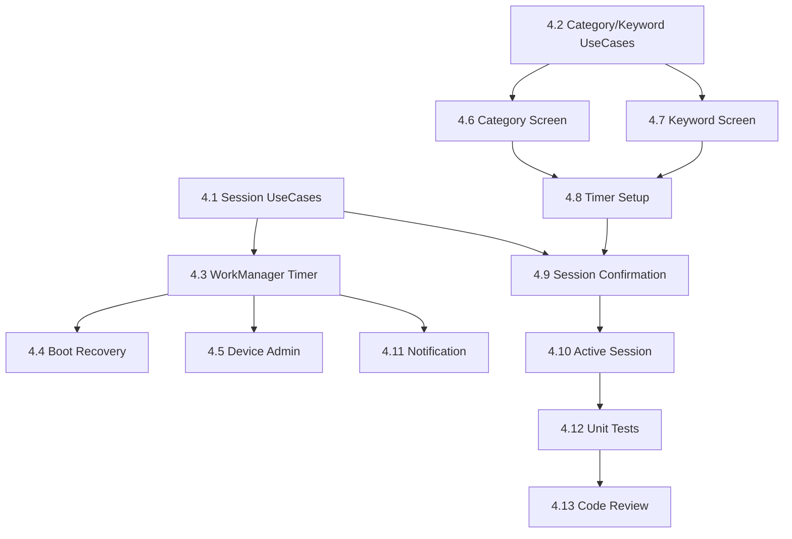

# Phase 4 — Session Management: Implementation Plan
## FocusLock Android App

---

> [!IMPORTANT]
> Phase 4 connects all the blocking infrastructure from Phase 3 to the user. Without this phase, the user has no way to configure keywords, set a timer, or start a session.

---

## 🎯 Phase 4 Objective

Build the complete session lifecycle:
1. **Category & Keyword selection UI** — user picks what to block
2. **Timer setup UI** — user picks how long
3. **Session activation** — starts all blocking services
4. **WorkManager timer** — reliable countdown that survives process death
5. **Boot recovery** — session survives device reboot
6. **Device Admin enforcement** — prevents uninstall during session
7. **Active session screen** — live countdown display
8. **Foreground notification** — persistent notification during session

---

## 📊 Current State Assessment

### ✅ Already Exists (Phase 1–3)

| Component | Status | Location |
|---|---|---|
| Room DB — all 7 entities + DAOs | ✅ Done | `data/local/entity/`, `data/local/dao/` |
| `SessionRepository` + impl | ✅ Done | `domain/repository/`, `data/repository/` |
| `BlockingRepository` + impl | ✅ Done | Keywords, categories, domains CRUD |
| `FocusAccessibilityService` | ✅ Done | URL detection + settings protection |
| `FocusVpnService` | ✅ Done | DNS interception + NXDOMAIN |
| `BlockingOverlayService` | ✅ Done | Full-screen overlay |
| `FocusDeviceAdminReceiver` | ✅ Scaffolded | Logs only, no uninstall lock logic |
| `BootReceiver` | ✅ Scaffolded | Logs only, no recovery logic |
| Navigation routes | ✅ Defined | All Phase 4 routes exist as placeholders |
| Domain models | ✅ Done | `Session`, `BlockedCategory`, `BlockedKeyword` |

### ❌ What Needs to Be Built

| Component | Current State |
|---|---|
| `ActivateSessionUseCase` | ❌ Not created |
| `DeactivateSessionUseCase` | ❌ Not created |
| `GetCategoriesUseCase` / `ToggleCategoryUseCase` | ❌ Not created |
| `AddKeywordUseCase` / `RemoveKeywordUseCase` | ❌ Not created |
| `SessionTimerWorker` (WorkManager) | ❌ Not created |
| `SessionExpiryWorker` (WorkManager) | ❌ Not created |
| `BootReceiver` real logic | ❌ Empty shell |
| `FocusDeviceAdminReceiver` uninstall lock | ❌ Empty shell |
| `CategorySelectionScreen` + ViewModel | ❌ Placeholder |
| `KeywordSelectionScreen` + ViewModel | ❌ Placeholder |
| `TimerSetupScreen` + ViewModel | ❌ Placeholder |
| `SessionConfirmationScreen` + ViewModel | ❌ Placeholder |
| `ActiveSessionScreen` + ViewModel | ❌ Placeholder |
| Foreground notification for session | ❌ Not created |
| Unit tests for all new UseCases/ViewModels | ❌ Not created |

---

## 🏗️ Task Breakdown — Build Order

> [!NOTE]
> Tasks ordered by dependency. Each feeds into the next.

---

### Task 4.1 — Domain Layer: Session UseCases
**Agent:** Domain Agent
**AI Skills:** `@brainstorming` → `@concise-planning` → `@mobile-developer` → `@kotlin-coroutines-expert`
**Priority:** 🔴 Critical — everything depends on this
**Reference:** `3_SYSTEM_DESIGN.md` §2.5, `4_DATA_MODEL.md` §1.1

**Files to create:**
```
domain/usecase/ActivateSessionUseCase.kt
domain/usecase/DeactivateSessionUseCase.kt
domain/usecase/GetSessionRemainingTimeUseCase.kt
```

**Responsibilities:**

| UseCase | Input | Output | Logic |
|---|---|---|---|
| `ActivateSessionUseCase` | `durationMillis: Long` | `Result<Long>` (session ID) | Validates no active session exists, calculates `expiresAt`, calls `sessionRepository.startSession()`, schedules WorkManager timer |
| `DeactivateSessionUseCase` | `sessionId: Long, status: SessionStatus` | `Result<Unit>` | Ends session in DB, cancels WorkManager timer, stops VPN + Accessibility monitoring |
| `GetSessionRemainingTimeUseCase` | None | `Flow<Long>` | Emits remaining millis every second from active session's `expiresAt` |

**Rules:**
- ❌ No Android imports — pure Kotlin + coroutines
- ✅ `ActivateSessionUseCase` must enforce single-active-session rule
- ✅ `expiresAt = System.currentTimeMillis() + durationMillis` — single source of truth

---

### Task 4.2 — Domain Layer: Category & Keyword UseCases
**Agent:** Domain Agent
**AI Skills:** `@mobile-developer` → `@kotlin-coroutines-expert`
**Priority:** 🔴 Critical — needed by selection screens
**Reference:** `2_USER_STORIES.md` US-03, US-04, `4_DATA_MODEL.md` §1.2–1.3

**Files to create:**
```
domain/usecase/GetAllCategoriesUseCase.kt
domain/usecase/ToggleCategoryUseCase.kt
domain/usecase/GetAllKeywordsUseCase.kt
domain/usecase/AddKeywordUseCase.kt
domain/usecase/RemoveKeywordUseCase.kt
```

| UseCase | Logic |
|---|---|
| `GetAllCategoriesUseCase` | Returns `Flow<List<BlockedCategory>>` from `BlockingRepository` |
| `ToggleCategoryUseCase` | Calls `blockingRepository.setCategoryActive(key, isActive)` |
| `GetAllKeywordsUseCase` | Returns `Flow<List<BlockedKeyword>>` |
| `AddKeywordUseCase` | Validates max 50 keywords, lowercase, calls `blockingRepository.addKeyword()` |
| `RemoveKeywordUseCase` | Calls `blockingRepository.removeKeyword(id)` |

**Rules:**
- ❌ No Android imports
- ✅ `AddKeywordUseCase` enforces 50-keyword MVP limit
- ✅ Keywords stored lowercase

---

### Task 4.3 — WorkManager: Session Timer
**Agent:** WorkManager Agent
**AI Skills:** `@mobile-developer` → `@kotlin-coroutines-expert`
**Priority:** 🔴 Critical — timer must survive process death
**Reference:** `3_SYSTEM_DESIGN.md` §2.5, `5_TECH_STACK.md` (WorkManager rule)

**Files to create:**
```
worker/SessionTimerWorker.kt
worker/SessionExpiryWorker.kt
worker/SessionWorkerScheduler.kt
```

**SessionTimerWorker:**
- Periodic worker (every 15 min) that checks if active session has expired
- If `expiresAt <= now`: calls `DeactivateSessionUseCase`, stops services
- Foreground notification shows remaining time

**SessionExpiryWorker:**
- OneTimeWork delayed to exact `expiresAt` timestamp
- Fires once at session end → ends session cleanly

**SessionWorkerScheduler:**
- Helper object that schedules/cancels both workers
- Called by `ActivateSessionUseCase` on start
- Called by `DeactivateSessionUseCase` on cancel

**Rules:**
- ✅ Use `WorkManager` — only mechanism that survives process death
- ✅ `setForeground()` with notification for ongoing work
- ✅ Use `ExistingWorkPolicy.REPLACE` with unique work name
- ❌ No `AlarmManager`, no `Handler.postDelayed`, no manual threads

---

### Task 4.4 — Boot Recovery
**Agent:** WorkManager Agent
**AI Skills:** `@mobile-developer` → `@mobile-security-coder`
**Priority:** 🔴 Critical — US-13 requirement
**Reference:** `3_SYSTEM_DESIGN.md` §7, `2_USER_STORIES.md` US-13

**File to modify:** `receiver/BootReceiver.kt`

**Logic:**
```
onReceive(BOOT_COMPLETED):
  1. Query Room DB for session with status=ACTIVE and expiresAt > now
  2. If found:
     a. Re-schedule SessionTimerWorker + SessionExpiryWorker
     b. Start FocusVpnService
     c. Show foreground notification with remaining time
  3. If not found or expired:
     a. Mark session COMPLETED if expired
     b. Do nothing
```

**Rules:**
- ✅ Use `goAsync()` for DB access in BroadcastReceiver
- ✅ Use Hilt `EntryPointAccessors` for DI
- ❌ Never start AccessibilityService programmatically (OS manages it)

---

### Task 4.5 — Device Admin Enforcement
**Agent:** Security Agent (mandatory)
**AI Skills:** `@mobile-developer` → `@mobile-security-coder`
**Priority:** 🟡 High — prevents uninstall circumvention
**Reference:** `3_SYSTEM_DESIGN.md` §2.4

**File to modify:** `service/admin/FocusDeviceAdminReceiver.kt`

**Logic to add:**
- `onDisableRequested()`: If active session exists, return warning message
- Helper function `isUninstallBlocked()`: checks session status via repository

**Rules:**
- ✅ Security Agent MUST review this file (Rule A3)
- ❌ Never log session details or phone numbers
- ✅ Device Admin stays active between sessions (not revoked on session end)

---

### Task 4.6 — Category Selection Screen
**Agent:** Android Compose Agent
**AI Skills:** `@mobile-design` → `@mobile-developer`
**Priority:** 🟡 High
**Reference:** `2_USER_STORIES.md` US-03

**Files to create:**
```
ui/setup/CategorySelectionScreen.kt
ui/setup/CategorySelectionViewModel.kt
```

**Screen shows:**
- List of 6 categories with toggle switches
- Each category shows `displayName` and `exampleDomains`
- "Next" button → navigates to KeywordSelection
- State driven by `GetAllCategoriesUseCase` Flow

---

### Task 4.7 — Keyword Selection Screen
**Agent:** Android Compose Agent
**AI Skills:** `@mobile-design` → `@mobile-developer`
**Priority:** 🟡 High
**Reference:** `2_USER_STORIES.md` US-04

**Files to create:**
```
ui/setup/KeywordSelectionScreen.kt
ui/setup/KeywordSelectionViewModel.kt
```

**Screen shows:**
- Text input to add keyword + "Add" button
- List of existing keywords with delete button each
- Counter showing "X / 50 keywords"
- "Next" button → navigates to TimerSetup

---

### Task 4.8 — Timer Setup Screen
**Agent:** Android Compose Agent
**AI Skills:** `@mobile-design` → `@mobile-developer`
**Priority:** 🟡 High
**Reference:** `2_USER_STORIES.md` US-05

**Files to create:**
```
ui/setup/TimerSetupScreen.kt
ui/setup/TimerSetupViewModel.kt
```

**Screen shows:**
- Hours picker (0–72) + Minutes picker (0–59)
- Minimum: 15 minutes, Maximum: 72 hours
- "Review & Lock In" button → navigates to SessionConfirmation

---

### Task 4.9 — Session Confirmation Screen
**Agent:** Android Compose Agent
**AI Skills:** `@mobile-design` → `@mobile-developer`
**Priority:** 🔴 Critical — deliberate activation point
**Reference:** `2_USER_STORIES.md` US-05, US-06

**Files to create:**
```
ui/setup/SessionConfirmationScreen.kt
ui/setup/SessionConfirmationViewModel.kt
```

**Screen shows:**
- Summary: selected categories, keywords, duration, trusted contact
- Large "🔒 Lock In" button (deliberate tap, not swipe)
- On tap: calls `ActivateSessionUseCase` → starts services → navigates to ActiveSession

**Rules:**
- ✅ After activation, `popUpTo` clears the setup backstack
- ✅ Services must start within 3–5 seconds (US-06)

---

### Task 4.10 — Active Session Screen
**Agent:** Android Compose Agent
**AI Skills:** `@mobile-design` → `@mobile-developer` → `@kotlin-coroutines-expert`
**Priority:** 🔴 Critical — the main screen during a session
**Reference:** `2_USER_STORIES.md` US-14

**Files to create:**
```
ui/session/ActiveSessionScreen.kt
ui/session/ActiveSessionViewModel.kt
```

**Screen shows:**
- Large countdown timer (hours:minutes:seconds)
- Status indicators: VPN active ✅, Accessibility active ✅
- "Request Early Unlock" button (→ Phase 6 placeholder for now)
- Auto-navigates to SessionComplete when timer hits zero

---

### Task 4.11 — Foreground Notification
**Agent:** WorkManager Agent
**AI Skills:** `@mobile-developer`
**Priority:** 🟢 Standard
**Reference:** `3_SYSTEM_DESIGN.md` §2.5

**File to create:**
```
notification/SessionNotificationManager.kt
```

**Responsibilities:**
- Creates notification channel on app start
- Shows persistent notification during active session
- Updates countdown text periodically
- Dismissed when session ends

---

### Task 4.12 — Unit Tests
**Agent:** Testing Agent
**AI Skills:** `@test-driven-development` → `@testing-patterns` → `@kotlin-coroutines-expert`
**Priority:** 🔴 Critical — per Rule A5 and E5

**Test files:**
```
test/domain/usecase/ActivateSessionUseCaseTest.kt
test/domain/usecase/DeactivateSessionUseCaseTest.kt
test/domain/usecase/AddKeywordUseCaseTest.kt
test/domain/usecase/ToggleCategoryUseCaseTest.kt
test/ui/setup/CategorySelectionViewModelTest.kt
test/ui/setup/KeywordSelectionViewModelTest.kt
test/ui/setup/TimerSetupViewModelTest.kt
test/ui/setup/SessionConfirmationViewModelTest.kt
test/ui/session/ActiveSessionViewModelTest.kt
```

**Key test cases:**
- `ActivateSessionUseCase` rejects if active session exists
- `ActivateSessionUseCase` computes `expiresAt` correctly
- `AddKeywordUseCase` rejects at 50 keywords
- `AddKeywordUseCase` lowercases input
- `TimerSetupViewModel` enforces min 15 min, max 72 hours
- `ActiveSessionViewModel` emits countdown correctly

---

### Task 4.13 — Code Review & Security Audit
**Agent:** Code Reviewer Agent → Security Agent
**AI Skills:** `@uncle-bob-craft` → `@production-code-audit` → `@mobile-security-coder`
**Priority:** 🔴 Critical — Rule A4

**Checklist:**
- [ ] No `!!` in Kotlin code
- [ ] No business logic in Composables
- [ ] No business logic in ViewModels (only state + UseCase delegation)
- [ ] All DAO reads return `Flow<T>`
- [ ] No `runBlocking` in production code
- [ ] No phone numbers or OTPs in logs
- [ ] Clean Architecture boundaries respected
- [ ] Every UseCase has at least one unit test

---

## 📐 Implementation Order



**Parallel tracks:**
- Track A: 4.1 → 4.3 → 4.4 → 4.5 (backend logic)
- Track B: 4.2 → 4.6 → 4.7 → 4.8 (setup screens)
- Merge: 4.9 → 4.10 → 4.11 → 4.12 → 4.13

---

## 🔐 Security Review Checkpoints

Per Master.md Rule A3, Security Agent MUST review:

| File | Why |
|---|---|
| `FocusDeviceAdminReceiver.kt` | Device Admin = uninstall prevention |
| `BootReceiver.kt` | Session recovery = security boundary |
| `ActivateSessionUseCase.kt` | Session state controls all blocking |
| `SessionWorkerScheduler.kt` | Timer manipulation = bypass vector |

---

## 📋 Acceptance Criteria Summary

| User Story | Criteria | Task |
|---|---|---|
| US-03 | 6 categories toggleable, persist across sessions | 4.6 |
| US-04 | Custom keywords, case-insensitive, max 50, deletable | 4.7 |
| US-05 | Duration 15min–72hrs, confirmation screen shows all selections | 4.8, 4.9 |
| US-06 | Services start within 3–5 sec, notification appears | 4.9, 4.11 |
| US-13 | Session survives reboot, services restart | 4.4 |
| US-14 | Countdown visible, services stop at zero, summary shown | 4.10 |
